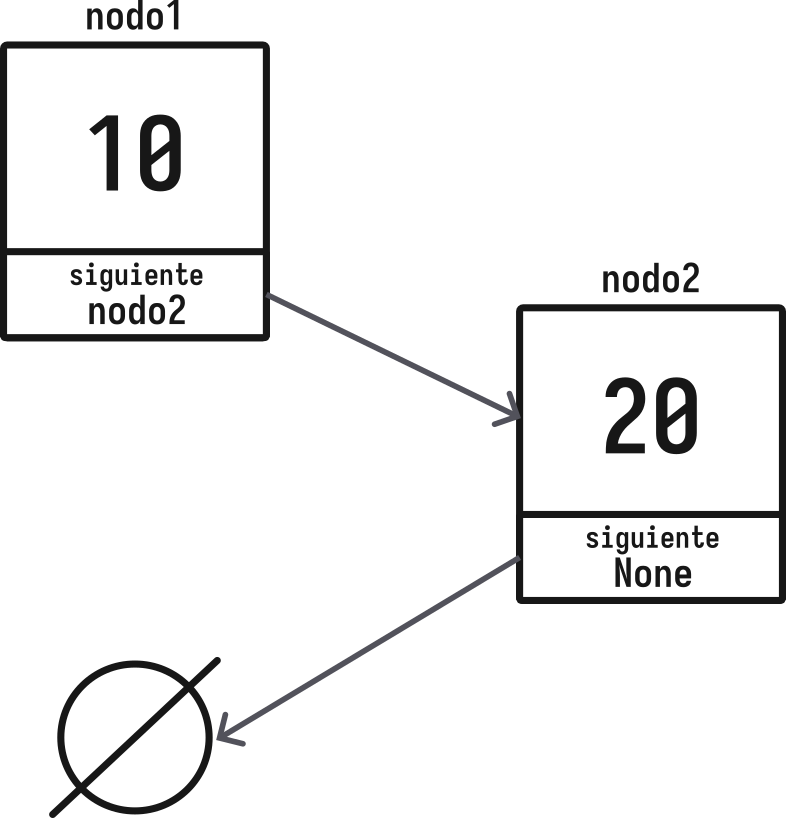
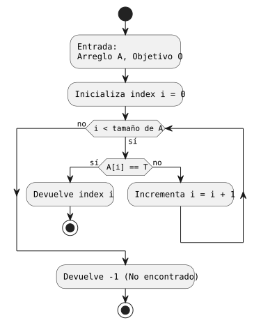
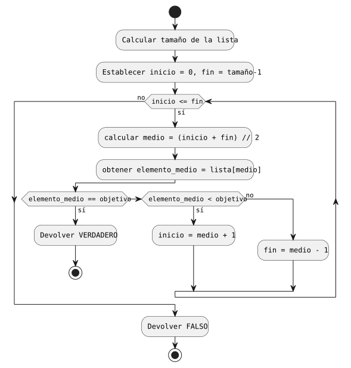

<!-- _class: cover -->
<!-- _paginate: false -->

# Estructuras de Datos y Algoritmos de Búsqueda

## Algoritmia y Estructuras de Datos

Dr. Jaime Jesús Delgado Meraz

### Unidad 02

#### IAD-2401


---

# Docente


Nombre
: Dr. Jaime Jesús Delgado Meraz

Correo
: <jesus.delgado@tecvalles.mx>
: <jaime.dm@cdvalles.tecnm.mx>

Enlaces
: :icon:brand-github: github.com/j2deme
: :icon:news: j2deme.github.io
: :icon:brand-instagram: j2deme

---

<!-- _class: cols-2 -->

# Asignatura

::: left

Nombre
: Algoritmia y Estructuras de Datos

Carrera
: Ingeniería en Inteligencia Artificial

:::
::: right

Clave
: IAD-2401

SATCA
: 2 - 3 - 5

:::

---

<!-- _class: toc -->

# Contenidos

1. [Tipos de datos abstractos](#tipos-de-datos-abstractos)
2. [Estructuras de datos](#estructuras-de-datos)
3. [Algoritmos de búsqueda](#algoritmos-de-b%C3%BAsqueda)

---

# Competencia Específica de la Unidad

> Selecciona e implementa estructuras de datos lineales y dinámicas adecuadas para resolver problemas, aplicando algoritmos de búsqueda eficientes según el contexto.

---

# Introducción

- Las estructuras de datos son una parte fundamental de la programación, ya que permiten organizar y manipular datos de una manera eficiente.
- Una **estructura de datos** es una forma de organizar un conjunto de datos elementales (números, caracteres, etc.) de tal manera que se puedan realizar operaciones sobre ellos.
- Con el uso de las estructuras de datos se pueden resolver problemas de una manera más eficiente, y así representar de una manera más "real" los datos que se manejan.

---

<!-- _class: lead -->

# Tipos de datos abstractos

---

# Tipos de datos abstractos (TDA)

> Es una abstracción de un tipo de dato, es decir, es una representación de un tipo de dato que se puede utilizar en un programa.

- Los TDA’s se pueden clasificar en:
  - **Tipos de datos**, son TDA’s que representan un tipo de dato, por ejemplo, un número entero, un número real, un carácter, etc., con funciones adicionales para manipularlos.
  - **Estructuras de datos**, son TDA’s que representan una estructura de datos, por ejemplo, una lista, una cola, una pila, etc.

---

# TDAs de tipos de datos

- Este tipo de TDA's son aquellos que representan un tipo de dato, por ejemplo, un número entero, un número real, un carácter, etc.
- Se diferencian de los tipos de datos nativos de un lenguaje de programación en que los TDA’s pueden tener operaciones que permiten manipular los datos que representan.

:::: flex
::: col 1/2 px-2

```java
int a = 5;
int b = 10;
int c = a + b;
```

:::
::: col 1/2 px-2

```java
Integer a = new Integer(5);
Integer b = Integer.valueOf(10);
Integer c = a.add(b);
c = a + b;
```

:::
::::

- Son muy útiles en casos en los que se requiere realizar algunas operaciones como la conversión de un tipo de dato a otro, o la validación de un dato.

---

# TDAs de tipos de datos

- En los lenguajes de programación de tipado dinámico, como Python, los TDA’s de tipos de datos son especialmente útiles para realizar operaciones como la conversión de un tipo de dato a otro.

:::: flex
::: col 1/3 px-1

```python
a = 5
b = 10
c = a + b # c = 15 ✅
```

:::
::: col 1/3 px-1

```python
a = 5
b = "10"
c = a + b # Error ❌
```

:::

::: col 1/3 px-1

```python
a = 5
b = int("10")
c = a + b # c = 15 ✅
```

:::
::::

- De hecho, en Python, los TDA’s de tipos de datos son tan importantes que fungen como **tipos de datos nativos**.

---

# TDAs de estructuras de datos

- Los TDA’s de estructuras de datos son aquellos que representan una estructura de datos, como una lista, una cola, una pila, etc.
- La mayoría de los lenguajes de programación modernos incluyen soporte nativo para estructuras como arreglos y cadenas de caracteres, mientras que para estructuras de datos más complejas como listas, colas, pilas, árboles, entre otras, suele ser necesario utilizar bibliotecas.
- Adicionalmente, si el lenguaje no da soporte a cierta estructura de datos, es posible implementarla utilizando los tipos de datos nativos del lenguaje, por ejemplo, utilizando arreglos.

---

# TDAs de estructuras de datos

- Los TDA’s de estructuras de datos permiten aprovechar las ventajas de las estructuras de datos, como la eficiencia en el uso de la memoria y en la ejecución de las operaciones.
- Los lenguajes de programación modernos suelen incluir bibliotecas desarrolladas por el mismo equipo que da soporte al lenguaje, las cuales incluyen estructuras de datos avanzadas.
- Por ejemplo, en el caso de Python, el lenguaje incluye una biblioteca llamada **collections**.

---

<!-- _class: inverted -->

# ¿Para que reinventar la rueda? 🚲🏍🚗

- Como se mencionó anteriormente, los lenguajes de programación modernos incluyen soporte nativo o extendido (bibliotecas) para estructuras de datos avanzadas.
- Entonces, ¿para que crear nuestras propias estructuras de datos?
  - La respuesta es simple, para aprender a crear nuestras propias estructuras de datos, entender mejor el funcionamiento de las mismas, así como poder adaptarlas a nuestras necesidades.
  - Además, en algunos casos, las estructuras de datos que incluyen los lenguajes de programación no son suficientes para resolver un problema en particular.
  - También nos facilita la comprensión de estructuras de datos más complejas o que no hayan sido desarrolladas por nosotros.

---

# Implementación de TDA's

## Lenguajes con soporte a la POO

- En los lenguajes de programación modernos con soporte a la programación orientada a objetos, los TDA’s se definen como **clases**, las cuales son una abstracción de un tipo de dato y permiten el aprovechamiento de la herencia y el polimorfismo.
- En estos lenguajes, la implementación de un TDA combina el paradigma de la programación orientada a objetos con las estructuras de datos, para definir atributos y métodos que permitan manipular los datos que representan.

---

# Implementación de TDA's

## Lenguajes sin soporte a la POO

- Los lenguajes de programación que no soportan la POO, también permiten definir TDA’s como estructuras, las cuales pueden tener atributos y funciones, sin embargo, se pierde el aprovechamiento de la herencia y el polimorfismo.
- Cabe mencionar que la mayoría de los lenguajes de programación modernos además de soportar la programación orientada a objetos, también incluyen estructuras de datos como parte del lenguaje, ya sea de manera nativa o mediante bibliotecas.

---

# Ejemplos de TDA’s

## Tipos de datos

:::: flex
::: col 1/2

- Los TDA’s de tipos de datos más comunes son:

| TDA                  | Python  |    Java     |
| -------------------- | :-----: | :---------: |
| Número entero        |  `int`  |  `Integer`  |
| Número real          | `float` |  `Double`   |
| Carácter             |  `str`  | `Character` |
| Cadena de caracteres |  `str`  |  `String`   |
| Booleano             | `bool`  |  `Boolean`  |

:::
::: col 1/2

- En lenguajes como Java, a los TDA’s de tipos de datos se les conoce como **wrappers** o **envoltorios** porque ofrecen funcionalidad adicional a los tipos de datos nativos del lenguaje.

:::
::::

---

# Ejemplos de TDA’s

## Estructuras de datos

:::: flex
::: col 1/2

- Los TDA’s de estructuras de datos más comunes son:

| TDA   | Python  |    Java     |
| ----- | :-----: | :---------: |
| Lista | `list`  | `ArrayList` |
| Cola  | `deque` |   `Queue`   |
| Pila  | `deque` |   `Stack`   |

:::

::: col 1/2

- Estos TDA's tienen diferentes implementaciones en cada lenguaje aunque su funcionalidad es la misma.
- Así mismo, existen otros TDA's de estructuras de datos más complejas como árboles, grafos, etc.

:::
::::

---

# Clasificación de las estructuras de datos

## Combinación de clasificaciones

| Estructura | Organización |  Tamaño  |   Acceso   |
| ---------- | :----------: | :------: | :--------: |
| Arreglo    |    Lineal    | Estático | Aleatorio  |
| Lista      |    Lineal    | Dinámico | Secuencial |
| Cola       |    Lineal    | Dinámico | Secuencial |
| Pila       |    Lineal    | Dinámico | Secuencial |
| Árbol      |  No lineal   | Dinámico | Aleatorio  |
| Grafo      |  No lineal   | Dinámico | Aleatorio  |

---

# Clasificación de las estructuras de datos

- Si bien existen diversas formas de clasificar las estructuras de datos, la clasificación más común es la que se basa en la organización de los datos (lineal o no lineal).
- Lo anterior se debe principalmente, a que dicha característica es la que más influye en el funcionamiento de las estructuras de datos.
- De hecho, las características de asignación de tamaño y acceso a los datos pueden variar entre los lenguajes de programación, mientras que la organización de los datos es una característica que se mantiene constante.

---

# Clasificación de las estructuras de datos

- Las estructuras de datos lineales se pueden clasificar en:
  - **Listas**, son estructuras en la que los datos se organizan de forma secuencial, es decir, cada dato se encuentra en un lugar específico de la lista.
  - **Colas**, en estas estructuras los datos se organizan de manera similar a las listas, pero los datos se agregan al final de la cola y se eliminan del inicio de la cola.
  - **Pilas**, estas estructuras se organizan de manera similar a las listas, con la diferencia de que los datos se agregan al final de la pila y se eliminan del final de la pila.

---

# Clasificación de las estructuras de datos

- Las estructuras de datos no lineales se pueden clasificar en:
  - **Árboles**, son estructuras en las que los datos se organizan de manera jerárquica, es decir, cada dato puede tener uno o más datos asociados a él.
    - Árboles binarios
    - Árboles n-arios
  - **Grafos**, estas estructuras son similares a los árboles, con la diferencia de que los datos pueden tener más de un dato asociado a ellos, y además, los datos pueden tener asociaciones entre sí.
    - Grafos dirigidos
    - Grafos no dirigidos
    - Grafos ponderados
    - Grafos no ponderados

---

<!-- _class: inverted -->

# Nota

- Tanto las estructuras de datos lineales como no lineales requieren de un **nodo** para almacenar los datos.
- Un nodo es una estructura que contiene los datos y las referencias a los nodos adyacentes.

---

<!-- _class: lead -->

# Nodo

---

# Nodo

> Un nodo es una estructura de datos que contiene un valor y una referencia a uno o más nodos.

- Se puede considerar como una caja que contiene un valor y un puntero a otro nodo.
- Los nodos se utilizan para construir estructuras de datos más complejas, como listas, pilas y colas.
- Son una estructura de datos fundamental en la programación.

---

# Nodo

- En la programación, un nodo se puede representar como una estructura o una clase[*:En la POO].

```python
class Nodo:
    def __init__(self, valor):
        self.valor = valor
        self.siguiente = None

nodo1 = Nodo(10)
nodo2 = Nodo(20)
nodo1.siguiente = nodo2
```



---

# Nodo

- La estructura de un nodo es muy simple, pero es la base para construir estructuras de datos más complejas.
- Puede contener cualquier tipo de dato, como enteros, flotantes, cadenas, objetos, etc.
- De manera básica, un nodo contiene:
  - Un valor o dato
  - Una referencia o puntero al siguiente nodo (en las estructuras lineales)
  - Referencias o punteros adicionales a otros nodos (en estructuras no lineales)

::: info
👨🏻‍🏫 Aunque la mayoría de los lenguajes modernos no requieren la creación de la estructura `Nodo`, se desarrollará para tomar como base de las estructuras de datos lineales
:::

---

<!-- _class: lead -->

# Estructuras de datos

---

# Estructuras de datos

## Arreglos

### Definición

> También conocidos como _arrays_, son estructuras de datos que almacenan una colección de elementos del mismo tipo en una ubicación contigua de memoria.

Se caracterizan por:

- Acceso directo por índice: $O(1)$
- Tamaño fijo (en su forma estática)

:::: flex
:::col 1/2

#### Ventajas

- Acceso rápido a cualquier elemento
- Bajo consumo de memoria adicional

:::
:::col 1/2

#### Desventajas

- Inserción/eliminación costosas ($O(n)$)
- Tamaño predefinido

:::
::::

---

<!-- _class: cols-2 -->

# Estructuras de datos

## Arreglos (Arrays)

### Operaciones

::: left

- En la mayoría de los lenguajes, las operaciones básicas son:
  - Acceso: `arr[i]` → $O(1)$
  - Modificación: `arr[i] = valor` → $O(1)$
  - Inserción: $O(n)$ (si no hay espacio)
  - Eliminación: $O(n)$ (requiere desplazamiento)

:::
::: right

```python
# Operaciones en Python
arr = [1, 2, 3, 4, 5]  # Creación
print(arr[2])          # Acceso → 3
arr[2] = 10            # Modificación
```

:::

---

# Estructuras de datos

## Matrices (Multidimensionales)

### Definición

> Es una estructura bidimensional basada en arreglos, utilizada para organizar datos en filas y columnas.
> Muy utilizada en la representación de matrices matemáticas y también para representar imágenes, tablas y tensores (_n-dimensionales_)

- **Acceso**: $O(1)$ por índice cuando las dimensiones son conocidas.
- **Recorrido completo**: $O(m×n)$ para una matriz $m×n$.

:::: flex
:::col 1/2

#### Ventajas

- Acceso eficiente por índice
- Adecuadas para operaciones matemáticas y representación tabular

:::
:::col 1/2

#### Desventajas

- Mayor complejidad en memoria y manejo de dimensiones
- No son ideales para inserciones/ eliminaciones frecuentes en medio

:::
::::

---

<!-- _class: cols-2 -->

# Estructuras de datos

## Matrices Multidimensionales

### Operaciones

::: left

- Acceso a elemento: $O(1)$
- Recorrido completo: $O(m×n)$
- Operaciones por filas/columnas: $O(m)$ o $O(n)$ según corresponda

:::
::: right

```python
# Matriz 3x3 en Python
matriz = [
  [1, 2, 3],
  [4, 5, 6],
  [7, 8, 9]
]

# Acceso a elemento
elemento = matriz[1][2]  # → 6

# Recorrido completo
for i in range(len(matriz)):
  for j in range(len(matriz[i])):
    print(f"matriz[{i}][{j}] = {matriz[i][j]}")
```

:::

---

# Estructuras de datos

## Listas

### Definición

> Colección dinámica de nodos, donde cada uno apunta al siguiente (enlaces simples) o también al anterior (listas dobles), son ideales cuando el tamaño cambia frecuentemente y las inserciones/eliminaciones se realizan con referencias directas.

- Puede ser de diferentes tipos: simples, dobles, circulares
- Acceso secuencial: $O(n)$
- Inserción/Eliminación (en posición conocida): $O(1)$

:::: flex
:::col 1/2

#### Ventajas

- Inserciones y eliminaciones eficientes si se conoce el nodo
- Flexible en tamaño (dinámico)

:::
:::col 1/2

#### Desventajas

- Acceso aleatorio costoso ($O(n)$)
- Mayor overhead por referencias/punteros

:::
::::

---

<!-- _class: cols-2 -->

# Estructuras de datos

## Listas

### Operaciones

::: left

- Inserción (al inicio/medio/final):
  - $O(1)$ si se tiene referencia,
  - $O(n)$ si se busca la posición
- Eliminación:
  - $O(1)$ con referencia al nodo,
  - $O(n)$ si se debe buscar
- Búsqueda: $O(n)$

:::
::: right

```python
class Nodo:
  def __init__(self, dato):
    self.dato = dato
    self.siguiente = None

class ListaSimple:
  def __init__(self):
    self.cabeza = None

  def insertar_inicio(self, dato):
    nodo = Nodo(dato)
    nodo.siguiente = self.cabeza
    self.cabeza = nodo

# Creación y uso
lista = ListaSimple()
lista.insertar_inicio(20)
lista.insertar_inicio(10)
```

:::

---

# Estructuras de datos

## Pilas

### Definición

> También conocidas como _stacks_, son estructuras de datos que siguen el principio de _"último en entrar, primero en salir"_ (LIFO).

- Estructura **LIFO** (Last In, First Out)

:::: flex
:::col 1/2

#### Ventajas

- Operaciones push/pop muy eficientes ($O(1)$)
- Sencilla implementación

:::
:::col 1/2

#### Desventajas

- Acceso limitado (solo cima)
- No apta para búsquedas eficientes

:::
::::

---

<!-- _class: cols-2 -->

# Estructuras de datos

## Pilas

### Operaciones

::: left

- `push()`: insertar en la cima → $O(1)$
- `pop()`: eliminar de la cima → $O(1)$
- `peek()`: ver cima → $O(1)$

:::
::: right

```python
class Pila:
  def __init__(self):
    self.items = []

  def push(self, item):
    self.items.append(item)

  def pop(self):
    return self.items.pop() if self.items else None

  def peek(self):
    return self.items[-1] if self.items else None
```

:::

---

# Estructuras de datos

## Colas (Queues)

### Definición

> Es una estructura caracterizada por ser una secuencia de elementos en la que la operación de inserción `enqueue` se realiza por un extremo y la operación de extracción `dequeue` por el otro, se basa en el principio _"lo último en entrar, es lo primero en salir"_ (FIFO)

- Estructura **FIFO** (First In, First Out)

:::: flex
:::col 1/2

#### Ventajas

- Orden natural para procesamiento por turnos
- Fácil de implementar con `deque` en Python

:::
:::col 1/2

#### Desventajas

- Operaciones centrales pueden costar si se usa lista simple (`pop(0)` → $O(n)$)
- No apta para acceso aleatorio eficiente

:::
::::

---

<!-- _class: cols-2 -->

# Estructuras de datos

## Colas (Queues)

### Operaciones

::: left

- `enqueue()`: insertar al final → $O(1)$
- `dequeue()`: eliminar del frente → $O(1)$ con `deque`
- `frente()`: ver elemento al frente → $O(1)$

:::
::: right

```python
from collections import deque

class Cola:
  def __init__(self):
    # deque evita el coste O(n) de pop(0)
    self.items = deque()

  def enqueue(self, item):
    self.items.append(item)

  def dequeue(self):
    return self.items.popleft() if self.items else None

  def frente(self):
    return self.items[0] if self.items else None
```

:::

---

# Estructuras de datos

## Punteros

### Definición

> Los punteros son variables que almacenan **direcciones de memoria**

- Son clave en estructuras dinámicas (listas, árboles, grafos)
- Permiten acceso indirecto y manipulación eficiente de datos

Los punteros son muy importantes:

- Sin punteros, no se pueden construir listas enlazadas ni árboles
- En lenguajes como Python, el manejo es implícito (referencias)
- En lenguajes como C o Rust, el manejo de **memoria es explícito y de bajo nivel**, lo que ofrece mayor control pero también mayor responsabilidad para el desarrollador

::: ok
En Python, todas las variables son referencias a objetos, lo que simplifica el manejo de estructuras dinámicas
:::

---

# Estructuras de datos

## Punteros

### Operaciones

Las operaciones más comunes con punteros incluyen:

- **Declaración**: Especificar el tipo de dato al que apunta el puntero
- **Asignación**: Asignar una dirección de memoria al puntero
- **Dereferenciación**: Acceder al valor almacenado en la dirección de memoria
- **Aritmética de punteros**: Realizar operaciones matemáticas con direcciones de memoria

---

<!-- _class: cols-2 -->

# Estructuras de datos

## Punteros

### Implementación

::: left

```c
// Ejemplo en C
int main() {
  int valor = 10;
  int *puntero = &valor;  // Puntero almacena la dirección de 'valor'
  printf("Valor: %d, Dirección: %p", *puntero, puntero);
  return 0;
}
```

```rust
// Ejemplo en Rust
fn main() {
  let valor = 10;
  let puntero = &valor;  // Referencia inmutable
  println!("Valor: {}", *puntero);
  println!("Dirección: {:p}", puntero);
}
```

:::
::: right

```python
# Ejemplo en Python
lista1 = [1, 2, 3]
lista2 = lista1  # Ambas variables apuntan al mismo objeto
lista2.append(4)
print(lista1)  # Output: [1, 2, 3, 4] - Mismo objeto modificado

```

:::

---

<!-- _class: split -->

# Estructuras de datos

## Punteros

### Características

::: left

#### Ventajas

- Permiten crear estructuras de datos dinámicas
- Facilitan el paso por referencia a funciones
- Optimizan el uso de memoria

:::
::: right

#### Desventajas

- Pueden causar fugas de memoria (_memory leaks_)
- Pueden generar punteros colgantes (_dangling pointers_)
- Añaden complejidad al código

:::
:::: bottom
::: warning
En lenguajes de bajo nivel como C, el mal uso de punteros puede causar errores difíciles de depurar y vulnerabilidades de seguridad
:::
::::

---

<!-- _class: lead -->

# Algoritmos de búsqueda

---

# Algoritmos de búsqueda

## Búsqueda Lineal

### Descripción

- Recorre secuencialmente cada elemento hasta encontrar el objetivo
- Funciona con datos **ordenados o desordenados**
- Complejidad temporal: $O(n)$
- Complejidad espacial: $O(1)$
- Es un algoritmo simple, pero ineficiente para grandes conjuntos



---

# Algoritmos de búsqueda

## Búsqueda Lineal

### Ejemplo

```python
# Usando listas nativas de Python
def busqueda_lineal(lista, objetivo):
    for i, elem in enumerate(lista):
        if elem == objetivo:
            return i  # Retorna índice
    return -1  # No encontrado

# Usando listas basadas en nodo
def buscar_lineal(listaSimple, objetivo):
  actual = listaSimple.cabeza

  # Recorrer todos los nodos de la lista
  while actual is not None:
      if actual.dato == objetivo:
          return True  # Elemento encontrado
      actual = actual.siguiente

  return False  # Elemento no encontrado

# Ejemplo
datos = [64, 34, 25, 12, 22]
pos = busqueda_lineal(datos, 25)  # → 2
```

---

<!-- _class: cols-2 -->

# Algoritmos de búsqueda

## Búsqueda Binaria

### Descripción

::: left

- Divide repetidamente el conjunto a la mitad
- Requiere que los datos estén **ordenados**
- Complejidad temporal: $O(log n)$
- Altamente eficiente para grandes conjuntos
- **Limitación**: Solo aplica a datos ordenados

:::
::: right

```python
def busqueda_binaria(arr, objetivo):
    izq, der = 0, len(arr) - 1
    while izq <= der:
        medio = (izq + der) // 2
        if arr[medio] == objetivo:
            return medio
        elif arr[medio] < objetivo:
            izq = medio + 1
        else:
            der = medio - 1
    return -1

# Ejemplo
ordenado = [10, 20, 30, 40, 50]
pos = busqueda_binaria(ordenado, 30)  # → 2
```

:::

---

# Algoritmos de búsqueda

## Búsqueda Binaria



---

<!-- _class: lead -->

# Cierre

---

# Cierre

## Comparación: Búsqueda Lineal vs Binaria

| Criterio           | Búsqueda Lineal      | Búsqueda Binaria           |
| ------------------ | -------------------- | -------------------------- |
| Complejidad        | $O(n)$               | $O(log \ n)$               |
| Orden requerido    | No                   | Sí                         |
| Eficiencia         | Baja (grandes datos) | Alta                       |
| Implementación     | Simple               | Moderada                   |
| Caso de uso típico | Pequeños datasets    | Grandes datasets ordenados |

---

# Cierre

## Guía de selección de estructuras

- **Acceso rápido por índice** → Arreglo
- **Inserciones/eliminaciones frecuentes** → Lista enlazada
- **Procesamiento LIFO** → Pila
- **Procesamiento FIFO** → Cola
- **Datos multidimensionales** → Matriz
- **Búsquedas en datos pequeños/no ordenados** → Lineal
- **Búsquedas en grandes conjuntos ordenados** → Binaria

---

# Cierre

## Aplicaciones en Inteligencia Artificial

- **Arreglos/Matrices**: Representan imágenes, tensores, pesos en redes neuronales
- **Pilas**: Backtracking en algoritmos de resolución
- **Colas**: BFS en planificación de rutas (A\*)
- **Búsqueda binaria**: Optimización de hiperparámetros

> La eficiencia algorítmica impacta directamente en el entrenamiento y predicción de modelos

---

# Cierre

## Errores comunes y soluciones

- **Error**: Usar búsqueda lineal en grandes datasets ordenados

  - **Solución**: Implementar búsqueda binaria

- **Error**: Implementar colas con `pop(0)` en listas grandes ($O(n)$)

  - **Solución**: Usar `collections.deque` o listas enlazadas

- **Error**: No considerar el costo de mantener datos ordenados

  - **Solución**: Evaluar frecuencia de búsquedas vs inserciones

---

<!-- _class: inverted centered pattern -->


<div class="text-center text-middle font-bold font-coding text-8xl mt-10">
  &lt;/Fin&gt;
</div>

---

<!-- paginate: skip -->
<!-- class: references -->

# Referencias

- Cormen, T. H., Leiserson, C. E., Rivest, R. L., & Stein, C. (2022). _Introduction to Algorithms_ (4th ed.). <https://mitpress.mit.edu/9780262046305/>
- Bhargava, A. Y. (2016). _Grokking Algorithms_. <https://www.manning.com/books/grokking-algorithms>
- Skiena, S. S. (2020). _The Algorithm Design Manual_ (3rd ed.). <https://www.springer.com/gp/book/9781848000698>
- Goodrich, M. T., & Tamassia, R. (2015). _Data Structures and Algorithms in Java_ (6th ed.). <https://www.wiley.com/en-us/Data+Structures+and+Algorithms+in+Java%2C+6th+Edition-p-9781118771334>
- Sedgewick, R., & Wayne, K. (2011). _Algorithms_. <https://algs4.cs.princeton.edu/home/>
- Lafore, R. (2021). _Data Structures and Algorithms in Java_. <https://www.oreilly.com/library/view/data-structures-and/9781118771334/>

---

# Referencias

- Nadal, M. (2019). _Estructuras de datos y algoritmos: Guía ilustrada para programadores_. <https://www.anayamultimedia.com/libro/estructuras-de-datos-y-algoritmos-guia-ilustrada-para-programadores/>
- Knuth, D. E. (1997). _The Art of Computer Programming, Volume 1: Fundamental Algorithms_ (3rd ed.). <https://www-cs-faculty.stanford.edu/~knuth/taocp.html>
- Microsoft Learn. (2024). _Data structures in C#_. <https://learn.microsoft.com/en-us/dotnet/csharp/programming-guide/concepts/linq/data-structures>
- W3Schools. (2024). _JavaScript Data Structures_. <https://www.w3schools.com/js/js_data_structures.asp>
- GeeksforGeeks. (2024). _Data Structures - GeeksforGeeks_. <https://www.geeksforgeeks.org/data-structures/>
- VisuAlgo. (2024). _Visualising Data Structures and Algorithms_. <https://visualgo.net/en>

---

# Referencias

- HackerRank. (2024). _Data Structures Challenges_. <https://www.hackerrank.com/domains/data-structures>
- LeetCode. (2024). _Data Structures and Algorithms_. <https://leetcode.com/problemset/data-structures/>
- Harvard CS50. (2024). _Algorithms_. <https://cs50.harvard.edu/x/2024/>
