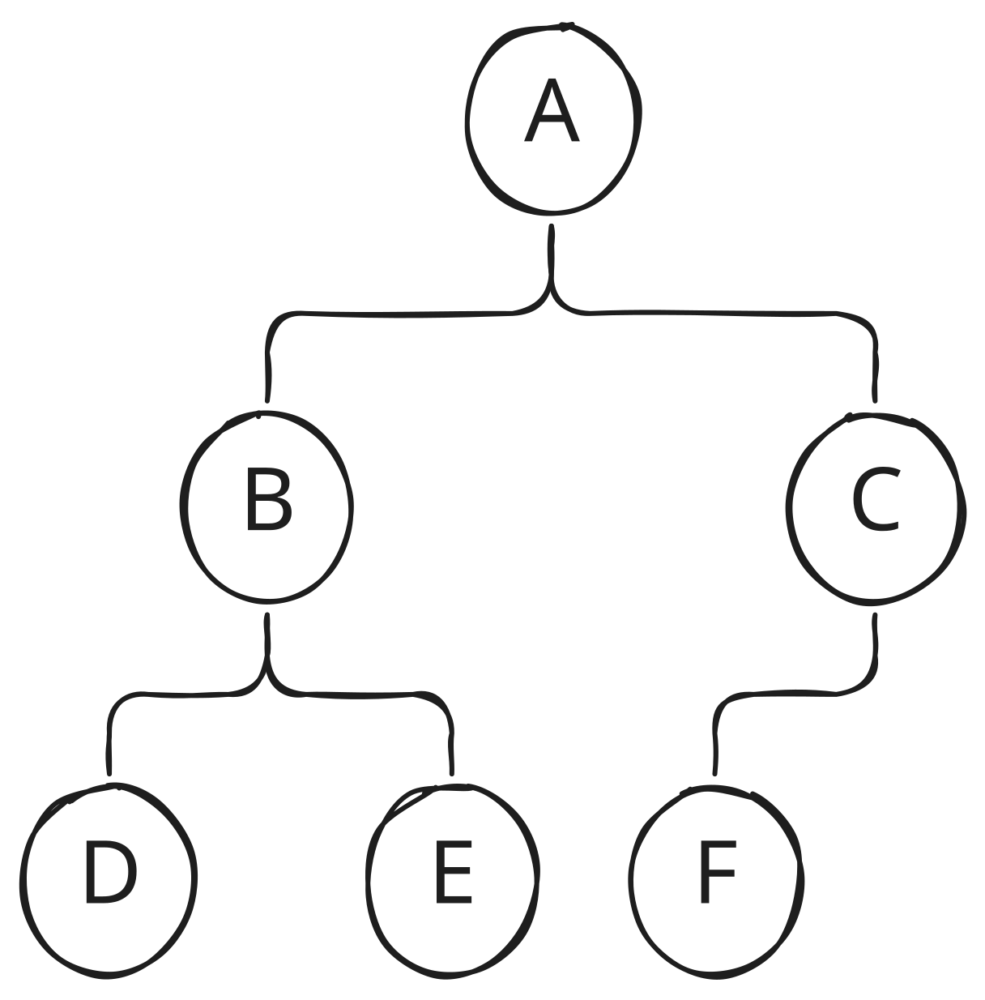
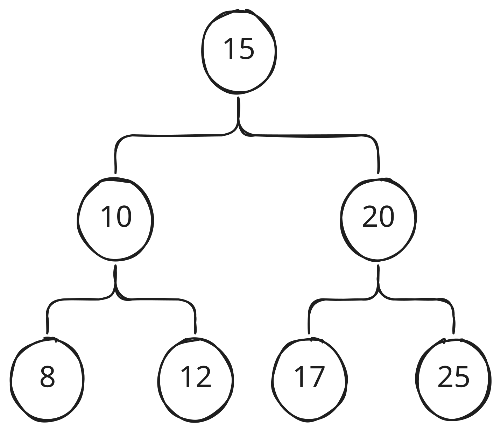

<!-- _class: cover -->
<!-- _paginate: false -->

# Algoritmos de Ordenamiento y Estructuras Avanzadas

## Algoritmia y Estructuras de Datos

Dr. Jaime Jesús Delgado Meraz

### Unidad 03

#### IAD-2401


---

# Docente


Nombre
: Dr. Jaime Jesús Delgado Meraz

Correo
: <jesus.delgado@tecvalles.mx>
: <jaime.dm@cdvalles.tecnm.mx>

Enlaces
: :icon:brand-github: github.com/j2deme
: :icon:news: j2deme.github.io
: :icon:brand-instagram: j2deme

---

<!-- _class: cols-2 -->

# Asignatura

::: left

Nombre
: Algoritmia y Estructuras de Datos

Carrera
: Ingeniería en Inteligencia Artificial

:::
::: right

Clave
: IAD-2401

SATCA
: 2 - 3 - 5

:::

---

<!-- _class: toc -->

# Contenidos

1. [Algoritmos de ordenamiento](#algoritmos-de-ordenamiento)
2. [Árboles binarios de búsqueda (BST)](<#árboles-binarios-de-búsqueda-(bst)>)
3. [Montículos (heaps) y colas de prioridad](<#montículos-(heaps)-y-colas-de-prioridad>)

---

# Competencia Específica de la Unidad

> Aplica algoritmos de ordenamiento y estructuras avanzadas como árboles binarios y montículos para optimizar procesos de clasificación y gestión de datos prioritarios.

---

<!-- _class: lead -->

# Algoritmos de ordenamiento

---

# Algoritmos de ordenamiento

## Conceptos básicos

> **Ordenar** es el proceso de organizar los elementos de una lista o conjunto en un orden específico, ya sea ascendente o descendente, según un criterio definido.

- El ordenamiento es uno de los problemas fundamentales en las ciencias de la computación; tiene un impacto directo en el rendimiento de búsquedas y otras operaciones.
- Existen diversos algoritmos de ordenamiento, cada uno con sus propias características, ventajas y desventajas.
- La elección del algoritmo de ordenamiento adecuado depende de factores como el tamaño de los datos, la naturaleza de los datos y los requisitos de rendimiento.
- Los tipos más comunes de algoritmos de ordenamiento se pueden clasificar en:
  - Cuadráticos
  - Logarítmicos
  - Lineales

---

<!-- _class: cols-3 -->

# Algoritmos de ordenamiento

## Conceptos básicos

::: left

### Cuadráticos

- Bubble Sort
- Insertion Sort
- Selection Sort
- Shell Sort

:::
::: center

### Logarítmicos

- Merge Sort
- Heap Sort
- QuickSort

:::
::: right

### Lineales

- Counting Sort
- Radix Sort
- Bucket Sort

:::

::: info
La clasificación por complejidad algorítmica no es absoluta, ya que la eficiencia de un algoritmo puede variar según el contexto y las características específicas de los datos a ordenar.
:::

---

# Algoritmos de ordenamiento

## Burbuja

- Es un algoritmo de ordenamiento simple que compara elementos adyacentes y los intercambia si están en el orden incorrecto, este proceso se repite hasta que la lista está ordenada.
- El algoritmo se llama "burbuja" porque los elementos más grandes "flotan" hacia la parte superior de la lista, como burbujas en un líquido.
- También se le conoce como **Bubble Sort**.

### Complejidad

- Mejor caso: $O(n)$ (cuando la lista ya está ordenada)
- Peor caso: $O(n^2)$ (cuando la lista está ordenada en orden inverso)
- Caso promedio: $O(n^2)$

---

<!-- _class: split -->

# Algoritmos de ordenamiento

## Burbuja

::: top
El algoritmo de **Bubble Sort** funciona de la siguiente manera, sea `A` una lista de `n` elementos, ordenados o no:
:::
::: left

```python
bubble_sort(A)
  n = tamaño(A)
  Desde i = 0 hasta n - 1
    Desde j = 0 hasta n - i - 1
      si A[j] > A[j + 1]
        intercambiar A[j] y A[j + 1]
```

Intercambiar, se refiere a cambiar la posición de dos elementos en el arreglo, por ejemplo:

```python
intercambiar(A[i], A[j])
  temp = A[i]
  A[i] = A[j]
  A[j] = temp
```

:::

```python
Arreglo inicial: [64, 34, 25, 12, 22]

Primera pasada:
[34, 64, 25, 12, 22] # 🔄 64 y 34
[34, 25, 64, 12, 22] # 🔄 64 y 25
[34, 25, 12, 64, 22] # 🔄 64 y 12
[34, 25, 12, 22, 64] # 🔄 64 y 22

Segunda pasada:
[25, 34, 12, 22, 64] # 🔄 34 y 25
[25, 12, 34, 22, 64] # 🔄 34 y 12
[25, 12, 22, 34, 64] # 🔄 34 y 22

Tercera pasada:
[12, 25, 22, 34, 64] # 🔄 25 y 12
[12, 22, 25, 34, 64] # 🔄 25 y 22

Resultado final: [12, 22, 25, 34, 64]
```

:::

---

# Algoritmos de ordenamiento

## Inserción

- Es un algoritmo de ordenamiento simple que construye la lista ordenada un elemento a la vez, se le conoce como **Insertion Sort**, funciona de manera similar a cómo las personas ordenan cartas en sus manos.
- El algoritmo divide la lista en dos partes: una parte ordenada y otra desordenada. Inicialmente, la parte ordenada contiene solo el primer elemento de la lista.
- A medida que se recorre la lista desordenada, cada elemento se toma y se _inserta_ en la posición correcta dentro de la parte ordenada.

### Complejidad

- Mejor caso: $O(n)$ (cuando la lista ya está ordenada)
- Peor caso: $O(n^2)$ (cuando la lista está ordenada en orden inverso)
- Caso promedio: $O(n^2)$

---

<!-- _class: split -->

# Algoritmos de ordenamiento

## Inserción

::: top
El algoritmo de **Insertion Sort** funciona de la siguiente manera, sea `A` una lista de `n` elementos:
:::
::: left

```python
insertion_sort(A)
  Desde i = 1 hasta tamaño(A)
    key = A[i]
    j = i - 1
    mientras j >= 0 y A[j] > key
      A[j + 1] = A[j]
      j = j - 1
    A[j + 1] = key
```

```python
# Iteración 1
     🔑
[64, 34, 25, 12, 22] # 64 > 34 🔄
 🔄  ◀
[34, 64, 25, 12, 22] # Inserta llave
# Iteración 2
         🔑
[34, 64, 25, 12, 22] # 64 > 25 🔄
     🔄  ◀
[34, 25, 64, 12, 22] # 34 > 25 🔄
 🔄  ◀
[25, 34, 64, 12, 22] # Inserta llave
```

:::
::: right

```python
# Iteración 3
             🔑
[25, 34, 64, 12, 22] # 64 > 12 🔄
         🔄  ◀
[25, 34, 12, 64, 22] # 34 > 12 🔄
     🔄  ◀
[25, 12, 34, 64, 22] # 25 > 12 🔄
 🔄  ◀
[12, 25, 34, 64, 22] # Inserta llave
# Iteración 4
                 🔑
[12, 25, 34, 64, 22] # 64 > 22 🔄
             🔄  ◀
[12, 25, 34, 22, 64] # 34 > 22 🔄
         🔄  ◀
[12, 25, 22, 34, 64] # 25 > 22 🔄
     🔄  ◀
[12, 22, 25, 34, 64] # Inserta llave
```

:::

---

# Algoritmos de ordenamiento

## Selección

- Es un algoritmo de ordenamiento simple que divide la lista en dos partes: una sublista ordenada que se construye de izquierda a derecha y una sublista desordenada con los elementos restantes.
- El algoritmo encuentra repetidamente el elemento mínimo de la sublista desordenada y lo coloca al final de la sublista ordenada.
- A diferencia de otros algoritmos, **Selection Sort** realiza un número mínimo de intercambios, lo que puede ser ventajoso cuando el costo de intercambiar es alto.

### Complejidad

- Mejor caso: $O(n^2)$ (independientemente del orden inicial)
- Peor caso: $O(n^2)$ (independientemente del orden inicial)
- Caso promedio: $O(n^2)$

---

<!-- _class: split -->

# Algoritmos de ordenamiento

## Selección

::: top
El algoritmo de Selection Sort funciona de la siguiente manera, sea `A` una lista de `n` elementos:
:::
::: left

```python
selection_sort(A)
  n = tamaño(A)
  Desde i = 0 hasta n - 2
    min_index = i
    Desde j = i + 1 hasta n - 1
      Si A[j] < A[min_index] entonces
        min_index = j
    Si min_index != i entonces
      intercambiar(A[i], A[min_index])
```

- 🔹 Posición _i_
- 🔻 Mínimo encontrado
- ▶ Inicio de búsqueda
- ◀ Fin de búsqueda

:::
::: right

```python
[64, 34, 25, 12, 22] # Arreglo inicial
# 1. i = 0, encuentra el mínimo 12
 🔹          🔻
[64, 34, 25, 12, 22]
  ▶           ◀
# 2. i = 1, encuentra el mínimo 22
     🔹          🔻
[12, 34, 25, 64, 22]
      ▶           ◀
# 3. i = 2, encuentra el mínimo 25
        🔹🔻
[12, 22, 25, 64, 34] # No hay cambio
          ▶   ◀
# 4. i = 3, encuentra el mínimo 34
             🔹  🔻
[12, 22, 25, 64, 34]
              ▶   ◀

[12, 22, 25, 34, 64] # Resultado final
```

:::

---

# Algoritmos de ordenamiento

## QuickSort

- El algoritmo **QuickSort** está basado en el paradigma **divide y vencerás**, que consiste en dividir el problema en subproblemas más pequeños, resolverlos de manera independiente y luego combinar sus soluciones para obtener la solución final.
- Primero, elige un "pivote" y particiona el arreglo:
  - Elementos menores al pivote → izquierda.
  - Elementos mayores al pivote → derecha.
- Luego aplica **QuickSort** recursivamente a las dos particiones.

### Complejidad

- Promedio: $O(n\ log\ n)$
- Peor caso: $O(n^2)$ – si el pivote es siempre el menor o mayor.
- Mejor caso: $O(n\ log\ n)$

---

# Algoritmos de ordenamiento

## QuickSort

### Elección del Pivote

La elección del pivote es crucial para el rendimiento de QuickSort. Un buen pivote divide el arreglo en partes aproximadamente iguales, mientras que un mal pivote puede llevar a un rendimiento deficiente.

Las estrategias comunes para elegir el pivote incluyen:

- Primer elemento.
- Último elemento (usado en implementación típica).
- Elemento central.
- Mediana de tres (primero, medio, último).

> La elección del pivote afecta significativamente el rendimiento.

---

<!-- _class: split -->

# Algoritmos de ordenamiento

## QuickSort

### Particionamiento de Lomuto

::: top

> El esquema de particionamiento de Lomuto es una técnica comúnmente utilizada en el algoritmo QuickSort para dividir un arreglo en dos partes basándose en un pivote seleccionado.

:::
::: left

- Elige un pivote (usualmente el último elemento).
- Reordena el arreglo de manera que todos los elementos menores que el pivote queden a su izquierda y los mayores a su derecha.
- Devuelve la posición final del pivote.

:::
::: right

```python
particion(A, inicio, fin)
  pivote = A[fin]
  i = inicio - 1
  Desde j = inicio hasta fin - 1
    Si A[j] < pivote entonces
      i = i + 1
      intercambiar A[i] y A[j]
  intercambiar A[i + 1] y A[fin]
  retornar i + 1
```

:::

---

<!-- _class: split -->

# Algoritmos de ordenamiento

## QuickSort

::: top
El algoritmo de QuickSort funciona de la siguiente manera, sea `A` una lista de `n` elementos:
:::
::: left

```python
quick_sort(A, bajo=0, alto=tamaño(A) - 1)
  Si bajo < alto entonces
    pi = particion(A, bajo, alto)
    quick_sort(A, bajo, pi - 1)
    quick_sort(A, pi + 1, alto)

particion(A, inicio, fin)
  pivote = A[fin]
  i = inicio - 1
  Desde j = inicio hasta fin - 1
    Si A[j] < pivote entonces
      i = i + 1
      intercambiar A[i] y A[j]
  intercambiar A[i + 1] y A[fin]
  retornar i + 1
```

:::
::: right

```python
Arreglo inicial: [64, 34, 25, 12, 22]

Pivote: 22 → Partición: [12, 22, 25, 64, 34]
│
├── Izq: [12] ✅
│
└── Der: [25, 64, 34]
    Pivote: 34 → Partición: [25, 34, 64]
    │
    ├── Izq: [25] ✅
    │
    └── Der: [64] ✅

Resultado final: [12, 22, 25, 34, 64]
```

:::

---

<!-- _class: cols-2 -->

# Algoritmos de ordenamiento

## QuickSort

### Visualización Paso a Paso

::: left

```python
ARREGLO INICIAL: [64, 34, 25, 12, 22]

PRIMERA PARTICIÓN (pivote=22, inicio=0, fin=4):
  0   1   2   3   4
 🔻              🔹
[64, 34, 25, 12, 22] # j=0, 64 < 22 ❌
     🔻          🔹
[64, 34, 25, 12, 22] # j=1, 34 < 22 ❌
         🔻      🔹
[64, 34, 25, 12, 22] # j=2, 25 < 22 ❌
             🔻  🔹
[64, 34, 25, 12, 22] # j=3, 12 < 22 ✅
🔄 A[0] y A[3]
[12, 34, 25, 64, 22]

Intercambio final
🔄 A[1] y A[4]
     🔹
[12, 22, 25, 64, 34] ◀ pivote en posición 1
```

:::
::: right

```python
SEGUNDA PARTICIÓN (pivote=34, inicio=2, fin=4):
  2   3   4
 🔻      🔹
[25, 64, 34] # j=2: 25 < 34 ✅
🔄 A[2] con A[2] (sin cambio)
[25, 64, 34]
     🔻  🔹
[25, 64, 34] # j=3: 64 < 34 ❌
[25, 64, 34]
Intercambio final
🔄 A[3] y A[4]
     🔹
[25, 34, 64] ◀ pivote en posición 3

TERCERA PARTICIÓN (pivote=34, inicio=2, fin=2):
  0   1   2   3   4
         🔻  🔹
[12, 22, 25, 34, 64] # ✅


RESULTADO FINAL: [12, 22, 25, 34, 64]
```

:::

---

# Algoritmos de ordenamiento

## Comparación de Algoritmos de Ordenamiento

| Algoritmo | Mejor Caso    | Caso Promedio | Peor Caso | Estable                                       | Espacio     |
| --------- | ------------- | ------------- | --------- | --------------------------------------------- | ----------- |
| Burbuja   | $O(n)$        | $O(n^2)$      | $O(n^2)$  | Sí                                            | $O(1)$      |
| Inserción | $O(n)$        | $O(n^2)$      | $O(n^2)$  | Sí                                            | $O(1)$      |
| Selección | $O(n^2)$      | $O(n^2)$      | $O(n^2)$  | No                                            | $O(1)$      |
| QuickSort | $O(n \log n)$ | $O(n \log n)$ | $O(n^2)$  | No[*:Variante estable posible, pero no común] | $O(\log n)$ |

---

# Algoritmos de ordenamiento

## Elección del Algoritmo de Ordenamiento

- La elección del algoritmo de ordenamiento depende de varios factores, sin embargo, algunos factores a considerar son:
  - **Tamaño del conjunto**: Pequeño → _InsertionSort_; Grande → _QuickSort_.
  - **Estado inicial**: Casi ordenado → _InsertionSort_.
  - **Memoria disponible**: Limitada → _InsertionSort_ / _SelectionSort_.
  - **Estabilidad requerida**: Sí → _InsertionSort_.

> Para uso general, _QuickSort_ es preferido por su eficiencia promedio, aunque alternativas como _MergeSort_ o _HeapSort_ pueden ser mejores en casos específicos.

---

<!-- _class: lead -->

# Árboles binarios de búsqueda (BST)

---

<!-- _class: split -->

# Árboles binarios de búsqueda (BST)

::: top

> Un árbol binario de búsqueda (BST) es una estructura de datos no lineal en forma de árbol, que se caracteriza por mantener sus elementos en un orden específico, permitiendo búsquedas, inserciones y eliminaciones eficientes.

- Está compuesta por **nodos** conectados por **aristas**.

:::
::: left

Raíz
: Es el nodo superior del árbol.

Hoja
: Nodo sin hijos.

:::
::: right

Hijo/Padre
: Relación entre nodos conectados.

Subárbol
: Árbol dentro de otro árbol.

:::

---

# Árboles binarios de búsqueda (BST)

## Representación y estructura

::: left

<!-- ```txt
       A
      /  \
     B    C
    / \   /
   D  E  F
``` -->

:::
::: right



- Raíz: `A`
- Hojas: `D`, `E`, `F`
- Subárbol izquierdo: `B - D - E`
- Profundidad de `C`: 1
- Altura del árbol: 2

:::

---

# Árboles binarios de búsqueda (BST)

## Definición y propiedades

- Los árboles binarios de búsqueda (BST) son un tipo especial de árbol donde cada nodo tiene **como máximo dos hijos**.
- Un hijo izquierdo y otro derecho, que pueden ser nulos.

### Propiedades

- El valor de cada nodo en el subárbol izquierdo es menor que el valor del nodo padre.
- El valor de cada nodo en el subárbol derecho es mayor que el valor del nodo padre.
- Ambos subárboles izquierdo y derecho también son árboles binarios de búsqueda.

::: info
Los árboles binarios de búsqueda permiten realizar operaciones de búsqueda, inserción y eliminación de manera eficiente, con una complejidad promedio de $O(\log n)$ para estas operaciones.
:::

---

# Árboles binarios de búsqueda (BST)

## Propiedad de orden

::: left

<!-- ```txt
       15
      /  \
    10    20
   / \    / \
  8  12  17 25
``` -->

:::
::: right



Se cumple la propiedad de orden:

- Nodo `15`: `10 < 15 < 20`
- Nodo `10`: `8 < 10 < 12`
- Nodo `20`: `17 < 20 < 25`

:::

---

# Árboles binarios de búsqueda (BST)

## Operaciones: inserción, búsqueda, eliminación

Los árboles binarios de búsqueda permiten realizar varias operaciones fundamentales:

- **Inserción**: Agregar un nuevo nodo al árbol manteniendo la propiedad de orden.
- **Búsqueda**: Encontrar un nodo con un valor específico.
- **Eliminación**: Remover un nodo del árbol y reestructurar el árbol para mantener la propiedad de orden.

### Complejidad

- Promedio: $O(\log n)$
- Peor caso: $O(n)$ (árbol desbalanceado)
- Mejor caso: $O(\log n)$

---

<!-- _class: split -->

# Árboles binarios de búsqueda (BST)

## Operaciones

### Implementación en Python

::: left

```python
class Nodo:
  """Nodo básico de un BST."""
  def __init__(self, valor):
    self.valor : int | str = valor
    self.izquierda : Nodo | None = None
    self.derecha : Nodo | None = None
```

Donde:

- `valor`: valor del nodo, que suele ser un número o cadena.
- `izquierda`: referencia al hijo izquierdo.
- `derecha`: referencia al hijo derecho.

Las funciones de inserción, búsqueda y eliminación suelen implementarse de manera **recursiva** para aprovechar la estructura jerárquica del árbol.

:::
::: right

```python
class BST:
  """Estructura básica de un árbol binario de búsqueda."""
  def __init__(self):
    self.raiz = None

  def insertar(self, valor):
    pass

  def buscar(self, valor):
    pass

  def eliminar(self, valor):
    pass

  def minimo(self, nodo):
    '''Encuentra el nodo con el valor mínimo en el subárbol dado.'''
    while nodo.izquierda is not None:
      nodo = nodo.izquierda
    return nodo
```

:::

---

<!-- _class: split -->

# Árboles binarios de búsqueda (BST)

## Operaciones

### Inserción

::: left

- La inserción de un nuevo nodo en un BST se realiza comparando el valor del nuevo nodo con los valores de los nodos existentes, comenzando desde la raíz.

```python
insertar(raiz, valor)
  Si raiz es nulo
    Crear nuevo nodo con valor -> retornar nodo
  Si valor < raiz.valor
    raiz.izq = insertar(raiz.izq, valor)
  Sino
    raiz.der = insertar(raiz.der, valor)
  Retornar raiz
```

:::
::: right

Si tenemos el siguiente árbol BST y queremos insertar un nuevo valor:

```txt
       15
      /  \
    10    20
   / \
  8  12
```

Al insertar `13`, se baja por la derecha de 10 y posteriormente por la derecha de 12.

```text
       15
      /  \
    10    20
   /  \
  8   12
        \
        13
```

:::

---

<!-- _class: split -->

# Árboles binarios de búsqueda (BST)

## Operaciones

### Búsqueda

::: left

- La búsqueda en un BST se realiza comparando el valor buscado con los valores de los nodos, comenzando desde la raíz y moviéndose a la izquierda o derecha según corresponda.

```python
buscar(raiz, valor)
  Mientras raiz no sea nulo
    Si valor == raiz.valor
      Retornar true
    Si valor < raiz.valor
      raiz = raiz.izq
    Sino
      raiz = raiz.der
  Retornar false
```

:::
::: right

Consideremos que se quiere buscar el valor `12` en el siguiente árbol BST:

```text
    15
   /  \
 10    20
 / \
8  12 ✅
```

1. Comenzar en la raíz `15`: `12 < 15` → ir a la izquierda.
2. En `10`: `12 > 10` → ir a la derecha.
3. En `12`: `12 == 12` → valor encontrado.

:::

---

<!-- _class: split -->

# Árboles binarios de búsqueda (BST)

## Operaciones

### Eliminación — Casos

::: left

La eliminación de un nodo en un BST es más compleja debido a los diferentes casos que pueden surgir:

- Caso **A** (hoja): simplemente eliminar el nodo.
- Caso **B** (un hijo): reemplazar el nodo por su hijo.
- Caso **C** (dos hijos): reemplazar el valor por el sucesor in-order (mínimo del subárbol derecho) y eliminar ese sucesor.

:::
::: right

```python
eliminar(raiz, valor)
  Si raiz es nulo
    Retornar nulo
  Si valor < raiz.valor
    raiz.izq = eliminar(raiz.izq, valor)
  Sino si valor > raiz.valor
    raiz.der = eliminar(raiz.der, valor)
  Sino
    # Encontrado para eliminar
    Si raiz.izq es nulo
      Retornar raiz.der
    Sino si raiz.der es nulo
      Retornar raiz.izq
    Sino
      sucesor = minimo(raiz.der)
      raiz.valor = sucesor.valor
      raiz.der = eliminar(raiz.der, sucesor.valor)
  Retornar raiz

minimo(nodo)
  Mientras nodo.izq no es nulo
    nodo = nodo.izq
  Retornar nodo
```

:::

---

<!-- _class: split -->

# Árboles binarios de búsqueda (BST)

## Operaciones

### Eliminación

::: left

Consideremos el siguiente árbol BST, donde buscamos eliminar el valor `10`:

```text
          15
        /  \
      10    20
     /  \
    8   12
```

- Dado que `10` tiene dos hijos, buscamos su sucesor _in-order_, que es `12`.
- Posteriormente, reemplazamos `10` con `12` y eliminamos el nodo original de `12`.

:::
::: right

```text
         15
        /  \
      12    20
     /  \
    8   ( )
```

**_in-order_** significa recorrer el árbol en el orden: izquierda, raíz, derecha

- En este caso, el sucesor _in-order_ de `10` es `12`, ya que es el valor más pequeño en el subárbol derecho de `10`.
- _¿Por qué 12 y no 8?_ 8 es menor que 10, por lo que no puede ser **sucesor**.

:::

---

<!-- _class: split -->

# Árboles binarios de búsqueda (BST)

## ¿Por qué usar _in-order_ para encontrar el sucesor?

::: top

El recorrido _in-order_ es el único que garantiza que los nodos se visiten en orden ascendente.

:::
::: left

_in-order_
: izquierda → raíz → derecha

_pre-order_
: raíz → izquierda → derecha

_post-order_
: izquierda → derecha → raíz

:::
::: right

```txt
       15
      /  \
    10    20
   / \
  8  12
```

- La revisión _in-order_ produce la secuencia: `8, 10, 12, 15, 20`.
- La revisión _pre-order_ produce: `15, 10, 8, 12, 20`.
- La revisión _post-order_ produce: `8, 12, 10, 20, 15`.

:::
::: bottom

Usar _pre-order_ o _post-order_ no garantiza encontrar el sucesor inmediato en términos de valor, lo que es crucial para mantener la propiedad de orden del BST durante la eliminación.

:::

---

# Árboles binarios de búsqueda (BST)

## Resumen

#### Complejidad

- Inserción: $O(h)$ — en promedio $O(log\ n)$, peor $O(n)$ (árbol desbalanceado).
- Búsqueda: $O(h)$ — en promedio $O(log\ n)$, peor $O(n)$.
- Eliminación: $O(h)$ — mismas consideraciones; en el caso de dos hijos se realiza una búsqueda del mínimo en el subárbol derecho.

#### Buenas prácticas

- Mantener el árbol balanceado si se requiere $O(log\ n)$ garantizado.
- Para conjuntos estáticos grandes, considerar estructuras alternativas (ordenación + búsqueda, B-trees con persistencia en disco).

---

<!-- _class: lead -->

# Montículos (heaps) y colas de prioridad

---

<!-- _class: split -->

# Montículos (heaps) y colas de prioridad

## Montículos

::: top

> Son estructuras no lineales especializadas, que permiten acceder rápidamente al elemento de mayor (o menor) prioridad, son la base para implementar colas de prioridad eficientes.

- Un montículo es una estructura de datos basada en árboles que satisface la propiedad de _heap_.
  - La propiedad de _heap_ asegura que el valor de cada nodo es mayor (o menor) que los valores de sus hijos, dependiendo de si es un montículo máximo o mínimo.
- En un montículo **máximo**, la raíz contiene el valor más grande, mientras que en un montículo **mínimo**, la raíz contiene el valor más pequeño.

:::
::: left

### Montículo máximo

```txt
        20
       /  \
     15    10
    /  \   /
   8   12 9
```

:::
::: right

### Montículo mínimo

```txt
        8
      /  \
     9    12
    / \   /
   10 15 20
```

:::

---

# Montículos (heaps) y colas de prioridad

## Montículos

- Un montículo es en esencia, un árbol binario casi completo que cumple la propiedad de _heap_:
  - Montículo máximo: cada nodo tiene un valor mayor o igual que sus hijos (la raíz es el máximo).
  - Montículo mínimo: cada nodo tiene un valor menor o igual que sus hijos (la raíz es el mínimo).
- Esta estructura permite operaciones eficientes de inserción y extracción del elemento de mayor o menor prioridad.
  - Debido a su forma casi completa, se puede representar de manera eficiente en un arreglo.

---

<!-- _class: split -->

# Montículos (heaps) y colas de prioridad

## Montículos

### Representación en arreglo

::: left

Si indexamos desde `0`, las relaciones de un nodo se pueden calcular así:

```python
padre(i) = floor((i - 1) / 2)
izq(i) = 2 * i + 1
der(i) = 2 * i + 2
```

Tomando el siguiente montículo máximo como ejemplo:

```txt
        20
       /  \
     15    10
    /  \   /
   8   12 9
```

:::
::: right

Las posiciones en el arreglo serían:

| Índice |  0  |  1  |  2  |  3  |  4  |  5  |
| ------ | :-: | :-: | :-: | :-: | :-: | :-: |
| Valor  | 20  | 15  | 10  |  8  | 12  |  9  |

Considerando el nodo en el índice `1` (valor `15`):

- Padre: `padre(1) = floor((1 - 1) / 2) = 0` → valor `20`
- Hijo izquierdo: `izq(1) = 2 * 1 + 1 = 3` → valor `8`
- Hijo derecho: `der(1) = 2 * 1 + 2 = 4` → valor `12`

:::

---

# Montículos (heaps) y colas de prioridad

## Montículos

### Cálculo de índices

- En un montículo representado como un arreglo, las relaciones entre nodos se pueden calcular utilizando fórmulas simples basadas en el índice del nodo.

```python
def parent(self, i):
    return (i - 1) // 2

def left(self, i):
  return 2 * i + 1

def right(self, i):
  return 2 * i + 2

def _compare(self, x, y):
  return x > y if self.max_heap else x < y
```

---

# Montículos (heaps) y colas de prioridad

## Montículos

### Representación en arreglo

- La representación en arreglo de un montículo es eficiente en términos de espacio y permite un acceso rápido a los elementos, y cuando se combina con las operaciones de _shift-up_ y _shift-down_, facilita la inserción y extracción de elementos manteniendo la propiedad de _heap_.
- Esta representación es especialmente útil en aplicaciones como colas de prioridad, donde se requiere un acceso rápido al elemento de mayor o menor prioridad.

::: info
Aunque un montículo es un árbol binario, es más eficiente representarlo como un arreglo debido a su estructura casi completa, lo que evita la necesidad de almacenar referencias adicionales para los nodos.
:::

::: ok
En un montículo representado como un arreglo, no se utilizan punteros ni referencias explícitas para los nodos, lo que reduce la sobrecarga de memoria y mejora la localización de datos en caché.
:::

---

<!-- _class: split -->

# Montículos (heaps) y colas de prioridad

## Montículos

### Shift-up / Shift-down

::: left

Shift-up
: Al insertar, se compara con el padre y sube mientras sea necesario.

Shift-down
: Mueve la raíz al final, y baja el nuevo valor intercambiando con el hijo mayor (o menor) según el tipo.

```python
class Monticulo:
  def __init__(self, A=None, max_heap=True):
    self.A = list(A) if A is not None else []
    self.max_heap = max_heap

  def _swap(self, i, j):
    self.A[i], self.A[j] = self.A[j], self.A[i]
```

:::
::: right

```python
def shift_up(self, i):
  while i > 0 and self._compare(self.A[i], self.A[self.parent(i)]):
    self._swap(i, self.parent(i))
    i = self.parent(i)

def shift_down(self, i, n=None):
  if n is None:
    n = len(self.A)
  while self.left(i) < n:
    j = self.left(i)
    if j + 1 < n and self._compare(self.A[j+1], self.A[j]):
      j = j + 1
    if self._compare(self.A[i], self.A[j]):
      break
    self._swap(i, j)
    i = j
```

:::

---

<!-- _class: split -->

# Monticulos (heaps) y colas de prioridad

## Montículos

### Inserción y extracción

::: left

- Si se considera una inserción en un montículo máximo, se añade el nuevo elemento al final del arreglo y se aplica _shift-up_ para restaurar la propiedad de _heap_.

```python
def insertar(self, clave):
    self.A.append(clave)
    self.shift_up(len(self.A) - 1)
```

- Si por otro lado, se inserta en un montículo mínimo, se sigue el mismo procedimiento pero se ajusta la comparación en _shift-up_ para mantener la propiedad de montículo mínimo.

:::
::: right

La extracción del máximo (o mínimo) implica intercambiar la raíz con el último elemento, eliminar el último elemento y aplicar _shift-down_ desde la raíz para restaurar la propiedad de _heap_.

```python
def extraer_max(self):
    if not self.A:
      raise IndexError('Se intento extraer de montículo vacío')
    top = self.A[0]
    last = self.A.pop()
    if self.A:
      self.A[0] = last
      self.shift_down(0)
    return top
```

:::

---

<!-- _class: split -->

# Montículos (heaps) y colas de prioridad

## Montículos

### Construir un heap

::: left

> El proceso de construir un montículo a partir de un arreglo desordenado se conoce como _heapify_ o construcción de heap.

- Consiste en aplicar _shift-down_ desde el último padre hasta la raíz.
- Tiene una complejidad de $O(n)$, es más eficiente que insertar uno a uno ($O(n\log n)$).

:::
::: right

```python
def build_heap(self):
    n = len(self.A)
    for i in range(self.parent(n - 1), -1, -1):
      self.shift_down(i)
```

:::

---

<!-- _class: split -->

# Montículos (heaps) y colas de prioridad

## Cola de prioridad (priority queue)

::: left

- Una cola de prioridad usa un montículo para ofrecer:
  - insertar en $O(\log n)$
  - extraer (máximo/mínimo) en $O(\log n)$
- Algunas aplicaciones de las colas de prioridad incluyen:
  - Planificación de procesos
  - El algoritmo de búsqueda en grafos Dijkstra
  - El algoritmo de Huffman para compresión de datos
  - Gestión de tareas programadas, entre otras.

:::
::: right

- En una cola de prioridad, cada elemento tiene una prioridad asociada, los elementos con mayor prioridad se atienden antes que aquellos con menor prioridad, independientemente del orden en que fueron añadidos a la cola.
- Un ejemplo común es el sistema de triaje en emergencias médicas, donde los pacientes con condiciones más graves reciben atención antes que aquellos con condiciones menos críticas.

:::

---

<!-- _class: split -->

# Montículos (heaps) y colas de prioridad

## Cola de prioridad (priority queue)

### Implementación mínima

::: left

- Python ofrece la librería `heapq` como _min-heap_; para _max-heap_ se puede insertar negando los valores.
- La librería proporciona funciones para:
  - `heappush(heap, item)`: insertar un elemento.
  - `heappop(heap)`: extraer el elemento mínimo.
  - `heapify(x)`: transformar una lista en un heap en $O(n)$.

:::
::: right

```python
import heapq

# Min-heap
H = []
heapq.heappush(H, 5)
heapq.heappush(H, 2)
heapq.heappush(H, 7)
heapq.heappop(H)  # devuelve 2

# Max-heap usando signos invertidos
Hmax = []
heapq.heappush(Hmax, -5)
heapq.heappop(Hmax)  # devuelve -5 -> 5
```

:::

---

<!-- _class: split -->

# Montículos (heaps) y colas de prioridad

## Cola de prioridad (priority queue)

### Comparación y complejidad

::: left

- Inserción: $O(\log n)$
- Extracción (máximo/mínimo): $O(\log n)$
- Construir heap (heapify): $O(n)$
- Acceso a máximo/mínimo: $O(1)$

**¿Qué la hace diferente de un _queue_ normal?**

- En una cola normal (FIFO), los elementos se procesan en el orden en que se añaden, mientras que en una cola de prioridad, el orden de procesamiento depende de la prioridad asignada a cada elemento.
- Esto permite una gestión más eficiente de tareas o elementos que requieren atención inmediata según su importancia o urgencia.

:::
::: right

- Las colas de prioridad son esenciales en aplicaciones donde la gestión eficiente de recursos y tareas es crucial, como en sistemas operativos, algoritmos de grafos y planificación de eventos.
- La implementación basada en montículos garantiza que las operaciones de inserción y extracción se realicen de manera eficiente, manteniendo siempre la propiedad de prioridad.

:::

---

<!-- _class: split -->

# Montículos (heaps) y colas de prioridad

## Casos de uso

::: left

- **Planificación de procesos**: Los sistemas operativos utilizan colas de prioridad para gestionar la ejecución de procesos, asegurando que los procesos más críticos reciban atención primero.
- **Algoritmos de grafos**: Algoritmos como Dijkstra y Prim utilizan colas de prioridad para seleccionar el siguiente nodo o arista con la menor distancia o peso.

:::
::: right

- **Compresión de datos**: El algoritmo de Huffman utiliza colas de prioridad para construir árboles de codificación eficientes.
- **Gestión de tareas**: En aplicaciones de gestión de tareas, las colas de prioridad permiten organizar y ejecutar tareas según su importancia o urgencia.

:::

---

<!-- _class: inverted centered pattern -->


<div class="text-center text-middle font-bold font-coding text-8xl mt-10">
  &lt;/Fin&gt;
</div>

---

<!-- paginate: skip -->
<!-- class: references -->

<!-- # Referencias

-
-
- -->
