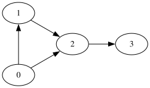

<!-- _class: cover -->
<!-- _paginate: false -->

# Técnicas Avanzadas de Diseño de Algoritmos

## Algoritmia y Estructuras de Datos

Dr. Jaime Jesús Delgado Meraz

### Unidad 04

#### IAD-2401


---

# Docente


Nombre
: Dr. Jaime Jesús Delgado Meraz

Correo
: <jesus.delgado@tecvalles.mx>
: <jaime.dm@cdvalles.tecnm.mx>

Enlaces
: :icon:brand-github: github.com/j2deme
: :icon:news: j2deme.github.io
: :icon:brand-instagram: j2deme

---

<!-- _class: cols-2 -->

# Asignatura

::: left

Nombre
: Algoritmia y Estructuras de Datos

Carrera
: Ingeniería en Inteligencia Artificial

:::
::: right

Clave
: IAD-2401

SATCA
: 2 - 3 - 5

:::

---

<!-- _class: toc -->

# Contenidos

1. [Grafos](#grafos)
2. [Algoritmos de búsqueda informada](#algoritmos-de-búsqueda-informada)
3. [Técnicas avanzadas de diseño](#técnicas-avanzadas-de-diseño)

---

# Competencia Específica de la Unidad

> Resuelve problemas complejos mediante algoritmos de búsqueda en grafos, técnicas informadas y estrategias avanzadas como programación dinámica y algoritmos voraces.

---

<!-- _class: lead -->

# Grafos

---

# Grafos

> Estructura de datos que representa relaciones entre objetos mediante nodos (vértices) y conexiones (aristas).

- Los grafos, antes de ser una estructura de datos, son un concepto matemático, utilizado para modelar relaciones entre objetos.
- Un grafo se compone de:
  - **Vértices** ($V$): también conocidos como nodos, representan los objetos.
  - **Aristas** ($E$): son las conexiones entre los nodos, representan las relaciones entre los objetos.
- Los grafos pueden ser dirigidos o no dirigidos, ponderados o no ponderados.

---


---

# Grafos

## Clasificación de grafos

- Los grafos pueden clasificarse en varios tipos según sus características:
  - Si las aristas tienen dirección o no (**dirigidos** vs **no dirigidos**).
  - Si las aristas tienen peso o costo asociado (**ponderados** vs **no ponderados**).
  - Si todos los vértices están conectados (**conexos** vs **no conexos**).
- Es importante entender que un grafo puede pertenecer a múltiples categorías simultáneamente.
- Además, existen tipos específicos de grafos:
  - **Grafos completos**: cada par de vértices está conectado por una arista.
  - **Grafos cíclicos**: contienen al menos un ciclo.
  - **Grafos acíclicos**: no contienen ciclos.
  - **Árboles**: grafos acíclicos conexos.

---

# Grafos

## Conceptos y representaciones

> Un grafo puede representarse de varias maneras en la memoria de una computadora, siendo las más comunes la matriz de adyacencia y la lista de adyacencia.

- La **matriz de adyacencia** es una matriz cuadrada donde el elemento en la fila $i$ y la columna $j$ indica si hay una arista entre los vértices $i$ y $j$, es muy eficiente para grafos densos.
- La **lista de adyacencia** es una colección de listas, donde cada lista corresponde a un vértice y contiene una lista de los vértices adyacentes, este tipo de representación es más eficiente para grafos dispersos.
- ¿Cómo elegir entre ambas representaciones?
  - Si el grafo es denso (muchas aristas), la matriz de adyacencia es preferible.
  - Si el grafo es disperso (pocas aristas), la lista de adyacencia es más eficiente en términos de espacio.

---

<!-- _class: split -->

# Grafos

## Conceptos y representaciones

### Matriz de Adyacencia

::: top

Una matriz de adyacencia para un grafo con $n$ vértices es una matriz $n \times n$ donde el elemento en la fila $i$ y la columna $j$ es 1 si hay una arista entre los vértices $i$ y $j$, y 0 en caso contrario.

:::
::: left

```python
# Ejemplo de matriz de adyacencia
import numpy as np
n = 4  # Número de vértices
adj_matrix = np.zeros((n, n))
# Agregar aristas
adj_matrix[0][1] = 1
adj_matrix[1][2] = 1
adj_matrix[2][3] = 1
```

:::
::: right

|       |  0  |  1  |  2  |  3  |
| :---: | :-: | :-: | :-: | :-: |
| **0** |  0  |  1  |  0  |  0  |
| **1** |  0  |  0  |  1  |  0  |
| **2** |  0  |  0  |  0  |  1  |
| **3** |  0  |  0  |  0  |  0  |

:::

---

<!-- _class: split -->

# Grafos

## Conceptos y representaciones

### Lista de Adyacencia

::: left

- Una lista de adyacencia para un grafo es una colección de listas, donde cada lista corresponde a un vértice y contiene una lista de los vértices adyacentes.
- En Python, una lista de adyacencia puede representarse utilizando un diccionario donde las claves son los vértices y los valores son listas de vértices adyacentes.

:::
::: right

```python
# Ejemplo de lista de adyacencia
adj_list = {
  0: [1, 2],
  1: [2],
  2: [3],
  3: []
}
```



:::

---

# Grafos

## Recorridos

> Los recorridos en grafos son técnicas para visitar todos los nodos de un grafo de manera sistemática.

- Dos de los algoritmos de recorrido más comunes son:
  - **DFS (Depth-First Search)**: Explora **tan lejos como sea posible** a lo largo de cada rama antes de retroceder.
  - **BFS (Breadth-First Search)**: Explora **todos los vecinos de un nodo** antes de moverse a los nodos del siguiente nivel.
- Ambos algoritmos son fundamentales para resolver problemas en grafos, como la búsqueda de caminos, la detección de ciclos y la conectividad.
- La elección entre DFS y BFS depende del problema específico y de las características del grafo, mientras que DFS es más adecuado para problemas que requieren explorar todas las posibilidades, BFS es ideal para encontrar la ruta más corta en grafos no ponderados.

---

# Grafos

## Recorridos

### DFS (Depth-First Search)

> El algoritmo **DFS**, también conocido como búsqueda en profundidad, explora tan lejos como sea posible a lo largo de cada rama antes de retroceder.

- DFS puede implementarse utilizando una pila (_stack_) para rastrear los nodos a visitar.
- El algoritmo comienza en un nodo raíz dado y explora cada rama antes de retroceder, marcando los nodos visitados para evitar ciclos.
- DFS es útil para problemas como la detección de ciclos, la generación de laberintos y la topología de grafos dirigidos acíclicos (DAGs).
- La complejidad temporal de DFS es $O(V + E)$, donde $V$ es el número de vértices y $E$ es el número de aristas en el grafo.

---

<!-- _class: split -->

# Grafos

## Recorridos

### DFS (Depth-First Search)

::: left

El pseudocódigo básico para el algoritmo DFS es el siguiente:

```txt
DFS(Grafo G, Nodo v):
  Marcar v como visitado
  Para cada vecino u de v:
    Si no visitado:
      DFS(G, u)
```

- Este pseudocódigo asume una implementación recursiva de DFS, donde se marca cada nodo como visitado y se llama recursivamente a DFS para cada vecino no visitado.

:::
::: right

Por su parte, una implementación básica en Python podría verse así:

```python
def dfs(grafo, inicio):
  visitado = set()
  pila = [inicio]
  while pila:
    v = pila.pop()
    if v not in visitado:
      visitado.add(v)
      pila.extend(reversed(grafo[v]))
  return visitado
```

- Se utiliza la función `reversed` para asegurar que los nodos se procesen en el orden correcto, mientras que la función `extend` añade los vecinos a la pila.

:::

---

# Grafos

## Recorridos

### BFS (Breadth-First Search)

> El algoritmo **BFS**, también conocido como búsqueda en anchura, explora todos los vecinos de un nodo antes de moverse a los nodos del siguiente nivel.

- BFS devuelve el camino más corto en grafos no ponderados y puede implementarse utilizando una cola (_queue_) para rastrear los nodos a visitar.
- El algoritmo comienza en un nodo raíz dado y explora todos los nodos vecinos antes de avanzar al siguiente nivel, marcando los nodos visitados para evitar ciclos.
- BFS es útil para problemas como la búsqueda de rutas más cortas, la detección de componentes conectados y la propagación de información en redes.
- La complejidad temporal de BFS es $O(V + E)$, donde $V$ es el número de vértices y $E$ es el número de aristas en el grafo.

---

<!-- _class: split -->

# Grafos

## Recorridos

### BFS (Breadth-First Search)

::: left
El pseudocódigo para describir la versión básica del algoritmo BFS es el siguiente:

```txt
BFS(Grafo G, Nodo inicio):
  Cola = [inicio]
  Marcar inicio como visitado
  Mientras cola no vacía:
    v = desencolar
    Para cada vecino u de v:
      Si no visitado:
        Marcar y encolar u
```

:::
::: right

Una implementación básica en Python podría verse así:

```python
from collections import deque

def bfs(grafo, inicio):
  visitado = set()
  cola = deque([inicio])
  visitado.add(inicio)
  while cola:
    v = cola.popleft()
    for vecino in grafo[v]:
      if vecino not in visitado:
        visitado.add(vecino)
        cola.append(vecino)
  return visitado
```

:::

---

# Grafos

## Implementaciones avanzadas

- Tanto DFS como BFS pueden implementarse de manera recursiva o iterativa, dependiendo de las necesidades específicas del problema.
- En grafos muy grandes, es importante considerar la gestión de la memoria y la eficiencia del algoritmo.
- Además, existen variaciones de estos algoritmos, como DFS iterativo con pila explícita y BFS bidireccional, que pueden mejorar el rendimiento en ciertos casos.
- La elección entre DFS y BFS debe basarse en el problema específico, las características del grafo y los requisitos de eficiencia.

---

# Grafos

## Implementaciones avanzadas

### DFS con tiempos

- En algunas aplicaciones, es útil registrar los tiempos de descubrimiento y finalización de cada nodo durante la ejecución de DFS.
- Estos tiempos pueden utilizarse para detectar ciclos, ordenar topológicamente grafos dirigidos acíclicos (DAGs) y encontrar componentes fuertemente conectados.
- La implementación de DFS con tiempos implica mantener dos listas adicionales para almacenar los tiempos de descubrimiento y finalización de cada nodo.

```python
def dfs_tiempos(grafo, inicio, tiempo, descubiertos, finalizados):
  tiempo[0] += 1
  descubiertos[inicio] = tiempo[0]
  for vecino in grafo[inicio]:
    if vecino not in descubiertos:
      dfs_tiempos(grafo, vecino, tiempo, descubiertos, finalizados)
  tiempo[0] += 1
  finalizados[inicio] = tiempo[0]
```

- Esta implementación registra el orden en que los nodos son descubiertos y finalizados durante la ejecución de DFS.

---

# Grafos

## Implementaciones avanzadas

### BFS con niveles

- En algunas aplicaciones, es útil conocer el nivel o la distancia de cada nodo desde el nodo raíz durante la ejecución de BFS.
- Esto es especialmente útil para encontrar la ruta más corta en grafos no ponderados y para analizar la estructura del grafo.

```python
from collections import deque

def bfs_niveles(grafo, inicio):
  niveles = {inicio: 0}
  cola = deque([inicio])
  while cola:
    v = cola.popleft()
    for vecino in grafo[v]:
      if vecino not in niveles:
        niveles[vecino] = niveles[v] + 1
        cola.append(vecino)
  return niveles
```

- Esta implementación responde a la pregunta de cuántos pasos se necesitan para llegar a cada nodo desde el nodo raíz.

---

<!-- _class: split -->

# Grafos

## Implementaciones avanzadas

### DFS completo

::: left

- El DFS completo es una variación del algoritmo DFS que asegura que todos los nodos del grafo sean visitados, incluso si el grafo no es conexo.
- Esta versión nos permite detectar puentes, componentes conectados y ciclos en grafos no conexos, entre otros.

```python
def dfs_completo(grafo):
  visitado = {u: False for u in grafo}
  padre = {u: None for u in grafo}
  entrada = {}
  salida = {}
  bajo = {}
  tiempo = [0]
```

:::
::: right

```python
  # Continuación del código
  def dfs_visit(v):
    visitado[v] = True
    tiempo[0] += 1
    entrada[v] = tiempo[0]
    bajo[v] = tiempo[0]

    for u in grafo[v]:
      if not visitado[u]:
        padre[u] = v
        dfs_visit(u)
        bajo[v] = min(bajo[v], bajo[u])
      elif u != padre[v]:
        bajo[v] = min(bajo[v], entrada[u])

    tiempo[0] += 1
    salida[v] = tiempo[0]

  for nodo in grafo:
    if not visitado[nodo]:
      dfs_visit(nodo)

  return entrada, salida, bajo, padre
```

:::

---

<!-- _class: split -->

# Grafos

## Implementaciones avanzadas

### BFS completo

::: left

- El BFS completo es una variación del algoritmo BFS que asegura que todos los nodos del grafo sean visitados, incluso si el grafo no es conexo.
- Esta versión es útil para analizar la estructura del grafo y encontrar componentes conectados en grafos no conexos, es tolerante a grafos dispersos, conexos o no conexos, nodos aislados, etc.

:::
::: right

```python
from collections import deque

def bfs_completo(grafo):
  visitado = {u: False for u in grafo}
  niveles = {}

  for nodo in grafo:
    if not visitado[nodo]:
      cola = deque([nodo])
      niveles[nodo] = 0
      visitado[nodo] = True

      while cola:
        v = cola.popleft()
        for vecino in grafo[v]:
          if not visitado[vecino]:
            visitado[vecino] = True
            niveles[vecino] = niveles[v] + 1
            cola.append(vecino)

  return niveles
```

:::

---

# Grafos

## ¿Cuándo usar DFS o BFS?

- La elección entre **DFS** y **BFS** depende del problema específico y de las características del grafo, considerando dar respuesta a preguntas como:
  - **¿Necesito encontrar la ruta más corta?** BFS es preferible en grafos no ponderados, mientras que para grafos ponderados se utilizan otros algoritmos como A\* o Dijkstra.
  - **¿Estoy explorando todas las posibilidades o buscando una solución específica?** DFS puede ser más adecuado dado que explora todas las ramas.
  - **¿El grafo es muy grande o tiene muchas ramas?** DFS puede ser más eficiente en términos de memoria, y BFS puede consumir más memoria debido a la cola.
  - **¿Necesito analizar la estructura del grafo o encontrar componentes conectados?** Ambos pueden ser útiles, DFS para ciclos y puentes, BFS para niveles y distancias.
  - **¿El grafo es denso o disperso?** Un grafo denso puede beneficiarse más de BFS, mientras que un grafo disperso puede ser mejor manejado por DFS.

---

<!-- _class: lead -->

# Algoritmos de búsqueda informada

---

# Algoritmos de búsqueda informada

---

# Algoritmos de búsqueda informada

## A\* (A-Estrella)

---

# Algoritmos de búsqueda informada

## Greedy Best-First

---

<!-- _class: lead -->

# Técnicas avanzadas de diseño

---

# Técnicas avanzadas de diseño

---

# Técnicas avanzadas de diseño

## Programación dinámica

---

# Técnicas avanzadas de diseño

## Algoritmos voraces (greedy)

---

<!-- _class: inverted centered pattern -->


<div class="text-center text-middle font-bold font-coding text-8xl mt-10">
  &lt;/Fin&gt;
</div>

---

<!-- paginate: skip -->
<!-- class: references -->

# Referencias

-
-
-
