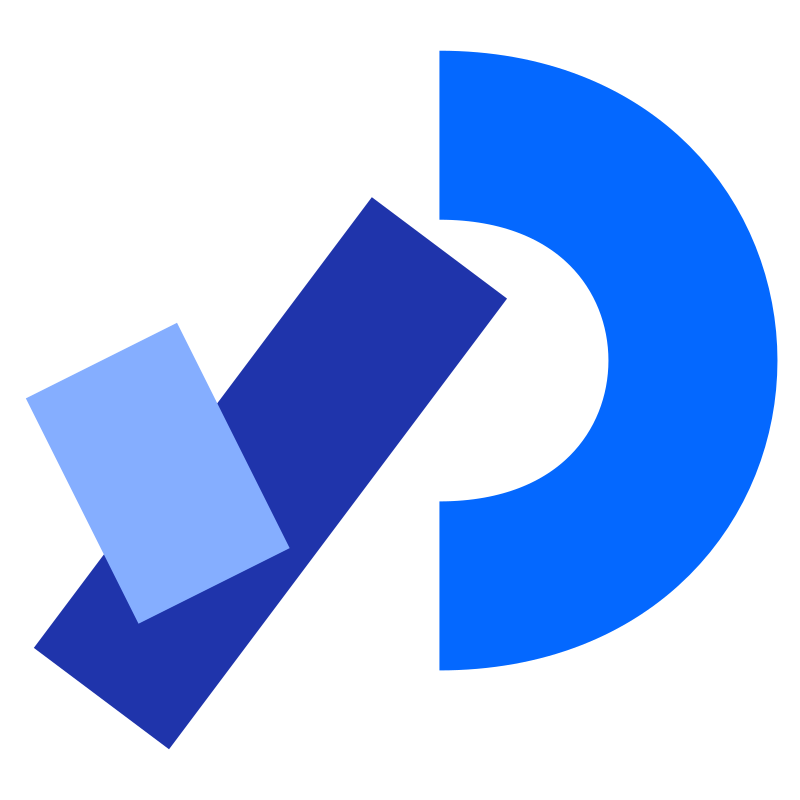
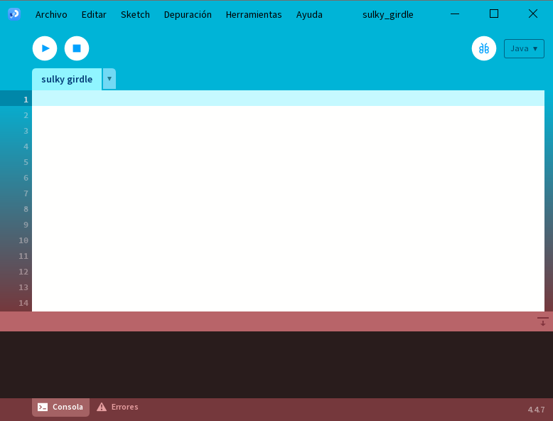
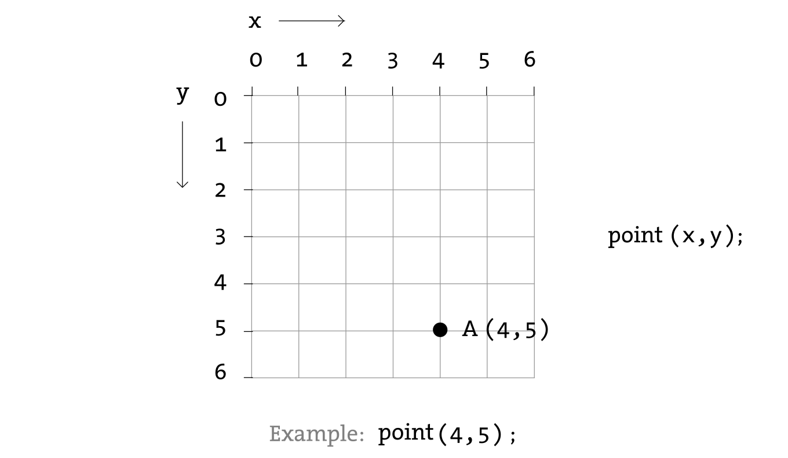

<!-- _header: '45 Aniversario Tec Valles' -->
<!-- _class: centered -->
<!-- _transition: fade -->
<!-- _paginate: false -->

# <!--fit--> Processing

## Programación para No Programadores

Ponente
: Dr. Jaime Jesús Delgado Meraz

Adscripción
: TecNM Campus Ciudad Valles

Evento
: 45 Aniversario, IT de Ciudad Valles




---

# Ponente


Nombre
: Dr. Jaime Jesús Delgado Meraz

Correo
: <jesus.delgado@tecvalles.mx>
: <jaime.dm@cdvalles.tecnm.mx>

Enlaces
: :icon:brand-github: github.com/j2deme
: :icon:news: j2deme.github.io
: :icon:brand-instagram: j2deme

---

# Objetivo

> Introducir a los asistentes al pensamiento creativo con código, usando Processing como herramienta visual e intuitiva para expresar ideas mediante formas, colores e interacción.

---

<!-- _class: toc -->

# Contenidos

1. [Introducción](#introduccion)
2. [Conceptos Básicos](#conceptos-basicos)
3. [Interacción Básica](#interaccion-basica)
4. [Repetición y Condiciones](#repeticion-y-condiciones)
5. [Conclusión](#conclusion)

---

<!-- _class: lead -->

# Introducción

---

# Introducción

## ¿Qué es Processing?

- Creado en **2001** por **Casey Reas** y **Ben Fry** (MIT Media Lab), fue creado con el objetivo de enseñar programación a artistas, diseñadores y principiantes
- Es un lenguaje visual, intuitivo y con retroalimentación inmediata.
- Está basado en Java, pero con una sintaxis mucho más amigable e intuitiva; actualmente también soporta JavaScript (p5.js) y Python (Processing.py)
- Es un proyecto de software libre y con una comunidad global muy activa.

::: quote
“Processing busca enseñar a pensar de forma computacional a través del arte.”
:::

---

<!-- _class: inverted centered -->

# <!--fit--> 🚨 ALTO 🚨

Antes de continuar, asegúrate de tener instalado Processing en tu computadora.

Crea una carpeta 📁 para tus proyectos, por ejemplo `Processing`.



---

# Introducción

## p5.js Web Editor

::: warning
Si llegaste hasta aquí y no tienes Processing instalado, no te preocupes 😉.
:::

- Processing cuenta con un editor en línea basado en JavaScript llamado **p5.js Web Editor**: <https://editor.p5js.org/>
- No requiere instalación
- Su sintaxis casi idéntica a la de Processing para lo básico.
- Es ideal si no tienes computadora o hay problemas técnicos.

```java
background(52, 121, 243);
fill(255, 204, 0);
ellipse(50, 50, 50, 50);
```

---

<!-- _class: lead -->

# Conceptos Básicos

---

# Conceptos Básicos

## El lienzo

También conocido como **canvas**, define el área de dibujo (ancho × alto en píxeles).

- Un _pixel_ es la unidad mínima de una imagen digital, representando un punto de color [o-:--red] [o-:--green] [o-:--blue].

```java
void setup() {
  size(600, 400); // Ancho: 600px, Alto: 400px
}
```

- La configuración del _canvas_ solo se llama **una vez**, dentro de `setup()`.
- El origen `(0, 0)` está en la esquina superior izquierda y las coordenadas aumentan hacia la derecha (`x`) y hacia abajo (`y`).

---

# Conceptos Básicos

## El lienzo



A diferencia de los sistemas de coordenadas matemáticos tradicionales, en Processing:

- El eje `y` crece hacia abajo.
- El punto `(0, 0)` está en la esquina superior izquierda.
- El punto `(width, height)` está en la esquina inferior derecha.

---

# Conceptos Básicos

## Estructura mínima

Todo _sketch_ en Processing tiene dos bloques esenciales:

```java
void setup() {
  // Aquí va la configuración inicial
  size(500, 300);
}

void draw() {
  background(255);
  // Dibuja aquí
}
```

- `setup()`: se ejecuta **una vez** al inicio.
- `draw()`: se repite ~60 veces por segundo.

::: warning
p5.js utiliza `createCanvas(400, 400);` en lugar de `size(400, 400);`
:::

---

# Conceptos Básicos

## Formas básicas

Si pensamos en Processing como un lienzo digital, las formas son las _pinceladas_ que usamos para crear imágenes.

- `point(x, y)`, dibuja un píxel
- `line(x1, y1, x2, y2)`, dibuja una línea
- `rect(x, y, ancho, alto)`, dibuja un rectángulo
- `ellipse(x, y, ancho, alto)`, dibuja un círculo u óvalo

```java
ellipse(250, 150, 80, 80);
rect(100, 200, 60, 40);
line(0, 0, width, height);
```

::: info
Las coordenadas empiezan en la **esquina superior izquierda** (0,0).
:::

---

# Conceptos Básicos

## Variables

Podemos usar variables para almacenar datos como números, texto y valores booleanos.

```java
int x = 100;          // número entero
float y = 150.5;     // número decimal
String name = "Processing"; // texto
boolean isActive = true; // verdadero/falso

ellipse(x, y, 50, 50);

x = x + 10; // mover 10 píxeles a la derecha
```

- Se declaran con un tipo (`int`, `float`, `String`, `boolean`)
- Se pueden cambiar en cualquier momento

---

<!-- _class: split -->

# Conceptos Básicos

## Textos

::: top
Processing permite dibujar texto fácilmente, con control sobre tamaño, alineación y fuente.
:::

::: left

- `text(str, x, y)` – dibuja texto
- `textSize(size)` – tamaño del texto
- `textAlign(alignX, alignY)` – alineación (`CENTER`, `LEFT`, `RIGHT`, `TOP`, `BOTTOM`)
- `textFont(font)` – fuente tipográfica (Se debe cargar con `createFont("Nombre", tamaño)`)
  :::
  ::: right

```java
textFont(createFont("Arial", 32)); // Cargar en setup()

textSize(32);
textAlign(CENTER, CENTER);
fill(32, 96, 223); // azul
text("Hola, Processing!", width/2, height/2);
```

:::

---

<!-- _class: split -->

# Conceptos Básicos

## Tiempos y animaciones

::: top
El bloque `draw()` se repite ~60 veces por segundo, permitiendo crear animaciones fluidas.
:::
::: left

- `frameCount` – número de cuadros desde el inicio
- `frameRate(fps)` – ajustar velocidad de cuadros por segundo
- `millis()` – milisegundos desde el inicio

:::
::: right

```java
void setup() {
  size(400, 400);
  frameRate(30); // 30 fps
  smooth();
}
void draw() {
  background(255);
  float x = frameCount % width; // mueve de izquierda a derecha
  ellipse(x, height/2, 50, 50);
}
```

:::

::: info
Para una imagen más suave puedes usar `smooth();` en `setup()`.
:::

---

<!-- _class: split -->

# Conceptos Básicos

## Colores

:::top
Aunque es posible dibujar exclusivamente en B/N, **Processing** permite usar colores fácilmente, por defecto en RGB, con valores de 0 a 255.
:::
::: left

- `background(r, g, b)` – fondo
- `fill(r, g, b)` – relleno de formas
- `stroke(r, g, b)` – contorno

:::
::: right

```java
background(240);        // gris claro
fill(255, 0, 0);       // rojo
stroke(0);             // negro
ellipse(250, 150, 100, 100);
```

:::
::: bottom

> Si no se especifica `fill()` o `stroke()` se usa el último valor definido, por defecto `fill(255)` y `stroke(0)`, para desactivar el relleno o el contorno totalmente, usamos `noFill()` o `noStroke()`.

:::

---

# Conceptos Básicos

## Colores

<div class="grid grid-cols-5 gap-1 p-2 text-center font-mono">
  <div class="bg-red p-2 rounded">rgb(197, 47, 33)</div>
  <div class="bg-pink p-2 rounded">rgb(217, 38, 98)</div>
  <div class="bg-fuchsia p-2 rounded">rgb(193, 32, 139)</div>
  <div class="bg-purple p-2 rounded">rgb(146, 54, 164)</div>
  <div class="bg-violet p-2 rounded">rgb(117, 64, 191)</div>
  <div class="bg-indigo p-2 rounded">rgb(82, 78, 210)</div>
  <div class="bg-blue p-2 rounded">rgb(32, 96, 223)</div>
  <div class="bg-azure p-2 rounded">rgb(1, 114, 173)</div>
  <div class="bg-cyan p-2 rounded">rgb(4, 120, 120)</div>
  <div class="bg-jade p-2 rounded">rgb(0, 122, 80)</div>
  <div class="bg-green p-2 rounded">rgb(57, 135, 18)</div>
  <div class="bg-lime p-2 rounded">rgb(108, 143, 0)</div>
  <div class="bg-yellow p-2 rounded">rgb(242, 223, 13)</div>
  <div class="bg-amber p-2 rounded">rgb(255, 191, 0)</div>
  <div class="bg-pumpkin p-2 rounded">rgb(255, 149, 0)</div>
  <div class="bg-orange p-2 rounded">rgb(210, 67, 23)</div>
  <div class="bg-gray p-2 rounded">rgb(171, 171, 171)</div>
  <div class="bg-zinc p-2 rounded">rgb(100, 107, 121)</div>
  <div class="bg-slate p-2 rounded">rgb(82, 95, 122)</div>
    <div class="bg-dark p-2 rounded">rgb(0, 0, 0)</div>
  <div class="bg-light p-2 rounded border border-solid border-black">rgb(255, 255, 255)</div>
</div>

---

# Conceptos Básicos

## Transparencia

Por defecto, los colores son opacos, pero se puede agregar un canal alfa para controlar la transparencia.

- Se agrega transparencia con un cuarto parámetro `alpha` (0 = transparente, 255 = opaco)

```java
fill(255, 0, 0, 127); // rojo semi-transparente
stroke(0, 0, 255, 200); // azul con algo de transparencia
ellipse(200, 200, 100, 100); // ¿De que color es el círculo? ❔
```

---

# Conceptos Básicos

## Mini reto 1

Usa un lienzo de 400×400 píxeles y dibuja:

- Un círculo rojo en el centro
- Un rectángulo azul en la esquina inferior derecha
- Una línea diagonal de esquina a esquina
- Escribe tu nombre en la parte superior izquierda

::: info
**Pista**: el centro es `(width/2, height/2)` y la esquina inferior derecha es `(width, height)`.
:::

---

# Conceptos Básicos

## Mini reto 1

### Solución

```java
void setup(){
  size(400, 400);
  smooth();
}

void draw(){
  background(255);
  fill(255, 0, 0);
  ellipse(200, 200, 60, 60);
  fill(0, 0, 255);
  rect(300, 300, 80, 50);
  line(0, 0, 400, 400);
  fill(0);
  text("Tu Nombre", 10, 20);
}
```

---

<!-- _class: lead -->

# Interacción Básica

---

# Interacción Básica

**Processing** puede responder en tiempo real a:

- El **mouse** (posición, clics)
- El **teclado** (teclas presionadas)

> ¡Tu sketch deja de ser estático y se vuelve vivo!


---

# Interacción Básica

## Posición del mouse

Existen dos variables especiales siempre disponibles:

- `mouseX` → posición horizontal del cursor
- `mouseY` → posición vertical del cursor

```java
void draw() {
  background(255);
  ellipse(mouseX, mouseY, 40, 40);
}
```

> El círculo sigue tu cursor en tiempo real.

---

# Interacción Básica

## Detectar clics del mouse

Para detectar si se ha hecho clic, se usa la variable booleana `mousePressed`:

```java
void draw() {
  background(255);

  if (mousePressed) {
    fill(255, 0, 0); // rojo
  } else {
    fill(0, 0, 255); // azul
  }

  ellipse(mouseX, mouseY, 50, 50);
}
```

> Cambia de color cuando haces clic.

---

# Interacción Básica

## Eventos: `mousePressed()`

También podemos usar una **función especial** que se ejecuta solo al hacer clic:

```java
void mousePressed() {
  println("¡Clic en (" + mouseX + ", " + mouseY + ")!");
}

void draw() {
  background(240);
}
```

> Ideal para disparar acciones puntuales (como crear una forma).

---

<!-- _class: split -->

# Interacción Básica

## Teclado: detectar teclas

::: left

- La variable `key` contiene la tecla presionada.
- Usa `keyPressed` (booleana) o la función `keyPressed()`.

:::
::: right

```java
void draw() {
  background(255);

  if (keyPressed) {
    if (key == 'a') {
      fill(0, 255, 0);
    } else {
      fill(255, 0, 0);
    }
  } else {
    fill(0);
  }

  ellipse(width/2, height/2, 80, 80);
}
```

:::
::: bottom

> Presiona **'a'** para cambiar a verde.[o:--green]

:::

---

# Interacción Básica

## Teclado: detectar teclas especiales

::: left

- Algunas teclas no son caracteres (F1, flechas, etc.)
- Usa la variable `keyCode` junto con constantes como `UP`, `DOWN`, `LEFT`, `RIGHT`, `ENTER`, `SHIFT`, etc.

:::
::: right

```java
void draw() {
  background(255);

  if (keyPressed) {
    if (keyCode == UP) {
      fill(0, 255, 0); // verde
    } else if (keyCode == DOWN) {
      fill(255, 0, 0); // rojo
    } else {
      fill(0);
    }
  } else {
    fill(0);
  }

  ellipse(width/2, height/2, 80, 80);
}
```

:::

---

# Interacción Básica

## Eventos: `keyPressed()`

Función que se ejecuta una vez por tecla presionada:

```java
void keyPressed() {
  if (key == ' ') {
    println("¡Espacio presionado!");
  }
}

void draw() {
  background(240);
}
```

> Útil para controles tipo “disparo”, “cambio de modo”, etc.

---

# Interacción Básica

## Mini reto 2

Crea un _sketch_ que:

- Dibuje un círculo en el centro, sin importar el tamaño del lienzo.
- Cambie su color a **verde** si pasas el mouse sobre él
- Se vuelva **más grande** si presionas la barra espaciadora

::: info
**Pista**: usa `dist()` para calcular distancia al centro.
:::

```java
float d = dist(mouseX, mouseY, width/2, height/2);
if (d < 40) { // Suponiendo que el círculo tiene tamaño 80
  /* dentro del círculo */
}
```

---

# Interacción Básica

## Mini reto 2

### Solución

```java
float size = 80;

void setup() {
  size(400, 400);
}

void draw() {
  background(255);
  float d = dist(mouseX, mouseY, width/2, height/2);
  if (d < size/2) {
    fill(0, 255, 0); // verde
  } else {
    fill(0); // negro
  }
  ellipse(width/2, height/2, size, size);
}

void keyPressed() {
  if (key == ' ') {
    size += 10; // aumenta tamaño
  }
}

```

---

<!-- _class: lead -->

# Repetición y condiciones

---

# Repetición y condiciones

Hasta ahora nos hemos limitado a dibujar **una forma a la vez**...

- Pero, ¿y si queremos dibujar **2**? ¿Y si queremos dibujar **10, 20** o **100**?

Aquí es donde entran en juego dos conceptos clave:

- `for`: para repetir acciones (bucles)
- `if / else`: para tomar decisiones

Estos conceptos nos permiten crear patrones, grillas, animaciones e interacciones más complejas.

---

# Repetición y condiciones

## El bucle `for`

Esta estructura permite repetir código un número definido de veces.

```java
for (int i = 0; i < 10; i = i + 1) {
  ellipse(i * 50, 200, 30, 30);
}
```

- `i` es un contador (empieza en 0)
- Se repite mientras `i < 10`
- Cada vez, `i` aumenta en 1

> Resultado: una fila de 10 círculos espaciados.

---

# Repetición y condiciones

## Patrones con bucles

Podemos usar `for` para crear grillas, líneas, mosaicos…

```java
for (int x = 0; x < width; x += 40) {
  for (int y = 0; y < height; y += 40) {
    rect(x, y, 30, 30);
  }
}
```

> Dibuja una **grilla de rectángulos** en toda la pantalla.

¡Ideal para fondos, texturas o diseños repetitivos!

---

# Repetición y condiciones

## Condiciones: `if / else`

Estas estructuras permiten ejecutar código **solo si se cumple una regla**.

```java
// Dentro de draw()
if (mouseX > width/2) {
  background(255, 0, 0); // rojo
} else {
  background(0, 0, 255); // azul
}
```

> El fondo cambia según si el mouse está en la mitad derecha o izquierda.

---

# Repetición y condiciones

## Combinando todo

Bucles + condiciones + interacción = ¡proyectos dinámicos!

```java
for (int i = 0; i < 20; i++) {
  float x = i * 30;
  if (x < mouseX) {
    fill(0, 200, 0); // verde
  } else {
    fill(200); // gris
  }

  rect(x, 200, 25, 25);
}
```

> Los rectángulos a la izquierda del cursor se vuelven verdes.

---

<!-- _class: primary centered -->

# <!--fit--> Hagamos una pausa

---

# Repaso

Hasta ahora hemos aprendido a:

- Dibujar formas y colores ✅
- Usar variables para almacenar datos ✅
- Crear animaciones básicas ✅
- Escribir texto ✅
- Responder al mouse y teclado ✅
- Detectar posición y clics del mouse ✅
- Detectar teclas presionadas ✅
- Repetir elementos con `for` ✅
- Tomar decisiones con `if` ✅

Ahora… ¡es tu turno de **crear algo propio**!

---

<!-- _class: lead -->

# Mini proyecto

---

# Mini proyecto

Para finalizar este taller, deberás crear una escena interactiva que use al menos:

- 3 formas distintas
- Texto
- Animación básica (movimiento o cambio de color)
- Colores personalizados
- Interacción (mouse o teclado)
- Bucles o condiciones

> ¡Sé creativo! No hay “código perfecto”, solo ideas visuales.

---

<!-- _class: lead -->

# Conclusión

---

# Conclusión

En este taller hemos visto cómo **Processing** facilita la programación visual e interactiva, incluso para quienes no tienen experiencia previa en código.

- Al usar formas, colores y texto, podemos expresar ideas de manera creativa.
- De manera similar a la programación tradicional, _la práctica hace al maestro_.

---

<!-- _class: inverted centered pattern -->


<div class="text-center text-middle font-bold font-coding text-8xl mt-10">
  &lt;/Fin&gt;
</div>

<div class="text-center text-middle text-4xl mt-10">
  Gracias por su atención
</div>

<script src="https://unpkg.com/@phosphor-icons/web"></script>
